# diorama — visão de negócio e catálogo de cenários

Documento de descoberta. Reúne a intenção do produto e todos os cenários de uso levantados até aqui, cada um com dados hipotéticos, a chamada de ferramenta que o agente faria e um wireframe da view resultante. A definição técnica do V1 está em [v1-definicao.md](v1-definicao.md).

Os wireframes e as chamadas são gerados a partir de `docs/scenarios/data-*.mjs` por `npm run docs`. As chamadas são validadas contra o schema real (`npm run test:scenarios`) e cada cenário roda de ponta a ponta na view (`npm run test:e2e`). Os wireframes são ilustrações estáticas; a view real, com a chamada editável, está no playground (`npm run preview`).

## 1. O problema

Agentes de código conversam por texto. Isso funciona para perguntas simples e falha em três situações recorrentes:

- **Comparar.** Três alternativas viram três parágrafos, e a comparação acontece na cabeça do usuário.
- **Entender estrutura.** Fluxos, dependências, estados e hierarquias são descritos em prosa quando são, por natureza, diagramas.
- **Responder em partes.** O usuário quer aprovar quatro passos de um plano e vetar um, e precisa escrever isso por extenso.

As ferramentas de pergunta que os agentes têm hoje oferecem selects, radios e campos de texto. Elas resolvem a resposta, mas não a compreensão que vem antes dela.

## 2. A proposta

Um servidor MCP que dá ao agente um **vocabulário visual pequeno e fechado** para **mostrar** (explicar, explorar, concluir) e **perguntar** (decidir, aprovar, priorizar) dentro do chat.

O agente envia dados estruturados e relações entre eles. A view decide layout, estilo e comportamento. Não há desenho livre: o agente combina componentes existentes, do mesmo modo que combina palavras.

**Para quem:** desenvolvedores que trabalham com agentes de código em clientes que renderizam MCP Apps (hoje, o chat do VS Code).

**O que o usuário ganha:**

- vê a estrutura do que o agente está propondo ou concluindo, em vez de reconstruí-la a partir de texto;
- explora por conta própria (lentes, passo a passo, perguntar sobre um elemento) sem gastar uma rodada de conversa para cada dúvida;
- responde com um clique por item, e a resposta volta ao agente num formato previsível;
- fica com um registro das decisões tomadas.

## 3. Princípios

1. **Vocabulário fechado.** Nada de HTML, wireframe ou canvas livre gerado pelo agente.
2. **Componentes pela forma do dado.** Grafo, árvore, matriz, e não "diagrama de X".
3. **Síntese, não dado bruto.** A view mostra a leitura do agente. Se a tela seria igual sem agente, Grafana, GitLens ou Jira fazem melhor.
4. **Retrato, não stream.** Os dados chegam na chamada; a view não consulta outros servidores.
5. **Interatividade declarativa.** O agente declara relações; a view deriva destaque, lentes e navegação.
6. **Resposta tipada e opcional.** Com pergunta, a resposta é estruturada. Sem pergunta, a view não bloqueia o agente.
7. **Só quando texto não basta.**

## 4. Vocabulário

**Ferramentas.** `present_view` mostra e não espera resposta. `present_decision` pergunta e espera.

**Componentes.**

| Componente | Forma do dado | Estado |
|---|---|---|
| `cards` | itens com resumo, prós e contras | implementado |
| `tradeoff` | itens × critérios, nota com motivo | implementado |
| `graph` | nós e arestas | implementado (variantes `flow`, `state`, `entity`, `commits`) |
| `timeline` | fases no tempo, por trilha | implementado |
| `tree` | hierarquia | implementado |
| `matrix` | linhas × colunas | implementado |
| `steps` | itens ordenados | implementado |
| `sequence` | atores × mensagens | implementado |
| `quadrant` | itens em dois eixos | implementado |
| `board` | cartões em colunas | implementado |
| `chart` | séries numéricas | implementado |

**Propriedades** (em qualquer elemento): `change` (added, removed, changed, affected), `status` (ok, warn, failed, pending, running, blocked, skipped), `emphasis` (normal, highlighted, faded), `note`.

**Estados.** Cada lente e cada cartão é um estado nomeado, e a view está sempre em um deles. `when` declara o que muda num estado; o valor fora do `when` vale nos demais. É a única relação que o agente declara.

**Mecanismos interativos:** estados (lentes e opções), passo a passo (`walkthrough`, que pode trocar o estado e focar elementos), destaque por id igual ao passar o mouse, perguntar sobre isto. Ainda não implementados: detalhe sob demanda, filtro, atualizar.

**Respostas:** `choose_one`, `choose_many`, `approve` (por item ou no todo); `choose_one` aceita vários blocos (uma escolha por bloco). Ainda não implementados: `rank`, `comment`.

## 5. Mapa de cenários

Todos os cenários rodam com o que está implementado. "Completo" indica que o cenário não depende de nenhum mecanismo ainda por fazer; os demais funcionam, com a limitação descrita no próprio cenário.

| # | Momento | Cenário | Ferramenta | Componentes | Resposta | Completo |
|---|---|---|---|---|---|---|
| 1 | Decidir | [Escolha de arquitetura](#1-architecture-choice) | `present_decision` | `cards`, `tradeoff`, `graph` | `choose_one` por item | sim |
| 2 | Decidir | [Escopo de uma feature](#2-feature-scoping) | `present_decision` | `cards`, `timeline` | `choose_one` por item | sim |
| 3 | Decidir | [Plano de migração ou rollout](#3-migration-rollout) | `present_decision` | `cards`, `timeline` | `choose_one` por item | sim |
| 4 | Decidir | [Estratégia de refatoração](#4-refactoring-strategy) | `present_decision` | `cards`, `graph` | `choose_one` por item | sim |
| 5 | Decidir | [Registro de decisões (ADR)](#5-decision-records) | `present_view` | `matrix` | nenhuma | sim |
| 6 | Alinhar | [Confirmar o entendimento do sistema](#6-system-understanding) | `present_decision` | `graph`, `steps` | `approve` por item | sim |
| 7 | Alinhar | [Ciclo de vida de uma entidade](#7-entity-lifecycle) | `present_view` | `graph` | nenhuma | sim |
| 8 | Alinhar | [Modelagem de dados e mudança de schema](#8-data-model-change) | `present_decision` | `graph`, `steps` | `approve` por item | sim |
| 9 | Alinhar | [Contrato de API e interação entre serviços](#9-api-contract) | `present_view` | `sequence` | nenhuma | sim |
| 10 | Aprovar | [Plano de implementação](#10-implementation-plan) | `present_decision` | `steps` | `approve` por item | sim |
| 11 | Aprovar | [Impacto de uma mudança (blast radius)](#11-blast-radius) | `present_decision` | `graph`, `tree` | `approve` no todo | sim |
| 12 | Aprovar | [Resumo de um PR agrupado por intenção](#12-pr-summary) | `present_decision` | `tree` | `approve` por item | sim |
| 13 | Priorizar | [Priorização de backlog ou dívida técnica](#13-backlog-prioritisation) | `present_decision` | `quadrant` | `choose_many` por item | sim |
| 14 | Priorizar | [Linha de corte de escopo](#14-scope-cut-line) | `present_decision` | `steps` | `choose_many` por item | sim |
| 15 | Priorizar | [Riscos e mitigações](#15-risk-assessment) | `present_decision` | `matrix`, `steps` | `choose_many` por item | sim |
| 16 | Diagnosticar | [Hipóteses de um bug](#16-bug-hypotheses) | `present_decision` | `tree` | `choose_one` por item | sim |
| 17 | Diagnosticar | [Linha do tempo de um incidente](#17-incident-timeline) | `present_view` | `timeline` | nenhuma | sim |
| 18 | Diagnosticar | [Padrão de erros nos logs](#18-log-error-heatmap) | `present_view` | `matrix`, `steps` | nenhuma | parcial |
| 19 | Diagnosticar | [Medições antes e depois](#19-performance-before-after) | `present_decision` | `chart`, `matrix` | `approve` no todo | sim |
| 20 | Especificar | [Regras de negócio e permissões](#20-business-rules) | `present_decision` | `matrix`, `steps` | `choose_many` por item | sim |
| 21 | Especificar | [Cenários de teste e cobertura](#21-test-scenarios) | `present_decision` | `matrix` | `choose_many` por item | sim |
| 22 | Git | [Divergência entre branches](#22-branch-divergence) | `present_view` | `graph` | nenhuma | sim |
| 23 | Git | [Resolução de conflitos de merge](#23-merge-conflicts) | `present_decision` | `cards` | `choose_one` por bloco | sim |
| 24 | Git | [Plano de cherry-pick ou rebase](#24-cherry-pick-plan) | `present_decision` | `steps` | `approve` por item | sim |
| 25 | CI/CD | [Execução de uma pipeline](#25-pipeline-run) | `present_view` | `graph` | nenhuma | sim |
| 26 | CI/CD | [Versões por ambiente](#26-versions-per-environment) | `present_view` | `matrix` | nenhuma | sim |
| 27 | CI/CD | [Testes instáveis](#27-flaky-tests) | `present_decision` | `matrix` | `choose_many` por item | sim |
| 28 | Ágil | [Quebra de épico em histórias e tarefas](#28-epic-breakdown) | `present_decision` | `tree` | `approve` por item | sim |
| 29 | Ágil | [Dependências entre tickets](#29-ticket-dependencies) | `present_view` | `graph` | nenhuma | sim |
| 30 | Ágil | [Quadro da sprint](#30-sprint-board) | `present_view` | `board` | nenhuma | sim |
| 31 | Ágil | [Rastreabilidade história × PR × teste × deploy](#31-traceability) | `present_view` | `matrix` | nenhuma | sim |
| 32 | Além | [Progresso do próprio agente](#32-agent-progress) | `present_view` | `steps`, `matrix` | nenhuma | parcial |
| 33 | Além | [Tour de codebase](#33-codebase-tour) | `present_view` | `graph` | nenhuma | parcial |
| 34 | Além | [Auditoria de dependências e segurança](#34-dependency-audit) | `present_decision` | `tree` | `choose_many` por item | sim |
| 35 | Além | [Diferença de configuração entre ambientes](#35-config-drift) | `present_view` | `matrix` | nenhuma | sim |
| 36 | Além | [Plano de query e perfil de performance](#36-query-plan) | `present_view` | `tree` | nenhuma | sim |

Dos 36 cenários, 33 estão completos.

## 6. Como ler cada cenário

- **Situação**, **Por que visual**, **O que o agente mostra**, **Interação**: a descrição de negócio.
- **Mensagem de volta**: o texto que a view envia ao chat quando há resposta.
- **Fontes**: de onde o agente tira os dados antes de chamar a ferramenta (outros MCPs, comandos, leitura de código).
- **Wireframe**: a view num estado de exemplo (uma lente ativa, um passo da narrativa, itens já marcados).
- **Chamada**: os argumentos que o agente enviaria. Em inglês, como o resto do desenvolvimento.


## Decidir

O agente tem alternativas reais e a escolha é cara de reverter. É o que o MVP já faz.

<a id="1-architecture-choice"></a>

### 1. Escolha de arquitetura

**Situação.** O agente precisa adicionar notificações em tempo real e há três caminhos viáveis, cada um com custo operacional diferente.

**Por que visual.** Em texto, cada alternativa vira um parágrafo e a comparação fica na cabeça do usuário. Lado a lado, com o fluxo de cada uma destacado, a diferença estrutural aparece.

**O que o agente mostra.** Cartões das alternativas, notas por critério com o motivo de cada nota, e um único grafo em que cada alternativa acende os seus nós.

**Interação.** Passar o mouse num cartão troca o estado da view: o grafo destaca o caminho daquela alternativa, marca o que ela acrescenta e onde passa a ficar a pressão (pods da API no SSE, Postgres no polling), e a tabela mostra os motivos dela.

| | |
|---|---|
| Ferramenta | `present_decision` |
| Componentes | `cards`, `tradeoff`, `graph` |
| Mecanismos | estados (opções), propriedades por estado (`when`) |
| Resposta | `choose_one` por item |
| Fontes | leitura do código, docs do load balancer |
| Ainda não implementado | nada |

**Mensagem de volta ao chat.**

```text
Decision on "Real-time notifications": go with "Server-Sent Events" (option id: sse).
Note: keep polling as fallback for the legacy mobile app
```

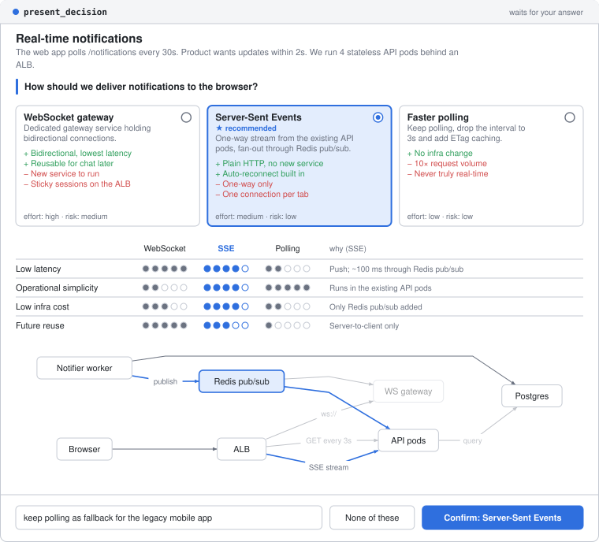

<details>
<summary>Chamada à ferramenta</summary>

```json
{
  "tool": "present_decision",
  "arguments": {
    "title": "Real-time notifications",
    "context": "The web app polls /notifications every 30s. Product wants updates within 2s. We run 4 stateless API pods behind an ALB.",
    "question": "How should we deliver notifications to the browser?",
    "blocks": [
      {
        "type": "cards",
        "id": "options",
        "items": [
          {
            "id": "ws",
            "title": "WebSocket gateway",
            "summary": "Dedicated gateway service holding bidirectional connections.",
            "pros": ["Bidirectional, lowest latency","Reusable for chat later"],
            "cons": ["New service to run","Sticky sessions on the ALB"],
            "effort": "high",
            "risk": "medium"
          },
          {
            "id": "sse",
            "title": "Server-Sent Events",
            "summary": "One-way stream from the existing API pods, fan-out through Redis pub/sub.",
            "pros": ["Plain HTTP, no new service","Auto-reconnect built in"],
            "cons": ["One-way only","One connection per tab"],
            "effort": "medium",
            "risk": "low",
            "recommended": true
          },
          {
            "id": "poll",
            "title": "Faster polling",
            "summary": "Keep polling, drop the interval to 3s and add ETag caching.",
            "pros": ["No infra change"],
            "cons": ["10× request volume","Never truly real-time"],
            "effort": "low",
            "risk": "low"
          }
        ]
      },
      {
        "type": "tradeoff",
        "items": [{"id":"ws","label":"WebSocket"},{"id":"sse","label":"SSE"},{"id":"poll","label":"Polling"}],
        "axes": [
          {"id":"latency","label":"Low latency"},
          {"id":"ops","label":"Operational simplicity"},
          {"id":"cost","label":"Low infra cost"},
          {"id":"reuse","label":"Future reuse"}
        ],
        "scores": [
          {"item":"ws","axis":"latency","value":5,"reason":"Push over an open socket"},
          {"item":"ws","axis":"ops","value":2,"reason":"New service plus sticky sessions"},
          {"item":"ws","axis":"cost","value":3,"reason":"Two extra pods"},
          {"item":"ws","axis":"reuse","value":5,"reason":"Chat and presence can share it"},
          {"item":"sse","axis":"latency","value":4,"reason":"Push; ~100 ms through Redis pub/sub"},
          {"item":"sse","axis":"ops","value":4,"reason":"Runs in the existing API pods"},
          {"item":"sse","axis":"cost","value":4,"reason":"Only Redis pub/sub added"},
          {"item":"sse","axis":"reuse","value":3,"reason":"Server-to-client only"},
          {"item":"poll","axis":"latency","value":2,"reason":"Up to 3 s by design"},
          {"item":"poll","axis":"ops","value":5,"reason":"Nothing new to run"},
          {"item":"poll","axis":"cost","value":2,"reason":"10× requests on API and DB"},
          {"item":"poll","axis":"reuse","value":1,"reason":"Dead end"}
        ]
      },
      {
        "type": "graph",
        "direction": "LR",
        "nodes": [
          {"id":"browser","label":"Browser"},
          {"id":"alb","label":"ALB"},
          {"id":"api","label":"API pods","when":{"sse":{"status":"warn","note":"one open connection per tab"}}},
          {
            "id": "gw",
            "label": "WS gateway",
            "emphasis": "faded",
            "when": {"ws":{"emphasis":"highlighted","change":"added","note":"new service to run"}}
          },
          {
            "id": "redis",
            "label": "Redis pub/sub",
            "emphasis": "faded",
            "when": {"ws":{"emphasis":"highlighted","change":"added"},"sse":{"emphasis":"highlighted","change":"added"}}
          },
          {"id":"worker","label":"Notifier worker"},
          {"id":"db","label":"Postgres","when":{"poll":{"status":"warn","note":"10x the read load"}}}
        ],
        "edges": [
          {"from":"browser","to":"alb"},
          {"from":"alb","to":"api","label":"SSE stream","emphasis":"faded","when":{"sse":{"emphasis":"highlighted"}}},
          {
            "from": "alb",
            "to": "api",
            "label": "GET every 3s",
            "emphasis": "faded",
            "when": {"poll":{"emphasis":"highlighted"}}
          },
          {"from":"alb","to":"gw","label":"ws://","emphasis":"faded","when":{"ws":{"emphasis":"highlighted"}}},
          {
            "from": "worker",
            "to": "redis",
            "label": "publish",
            "emphasis": "faded",
            "when": {"ws":{"emphasis":"highlighted"},"sse":{"emphasis":"highlighted"}}
          },
          {"from":"redis","to":"api","emphasis":"faded","when":{"sse":{"emphasis":"highlighted"}}},
          {"from":"redis","to":"gw","emphasis":"faded","when":{"ws":{"emphasis":"highlighted"}}},
          {"from":"worker","to":"db"},
          {"from":"api","to":"db","label":"query","emphasis":"faded","when":{"poll":{"emphasis":"highlighted"}}}
        ]
      }
    ],
    "response": {"type":"choose_one","of":"options"}
  }
}
```

</details>

<a id="2-feature-scoping"></a>

### 2. Escopo de uma feature

**Situação.** O pedido é "exportar relatórios". O agente enxerga três tamanhos possíveis de entrega e precisa saber qual construir.

**Por que visual.** O que diferencia os escopos é o que entra e quanto demora; uma linha do tempo por escopo mostra as duas coisas de uma vez.

**O que o agente mostra.** Um cartão por escopo e uma trilha de fases por escopo na mesma escala de tempo.

**Interação.** O cartão em foco destaca a trilha correspondente.

| | |
|---|---|
| Ferramenta | `present_decision` |
| Componentes | `cards`, `timeline` |
| Mecanismos | estados (opções), destaque ligado |
| Resposta | `choose_one` por item |
| Fontes | ticket de origem, leitura do código |
| Ainda não implementado | nada |

**Mensagem de volta ao chat.**

```text
Decision on "Report export scope": go with "Standard" (option id: standard).
```

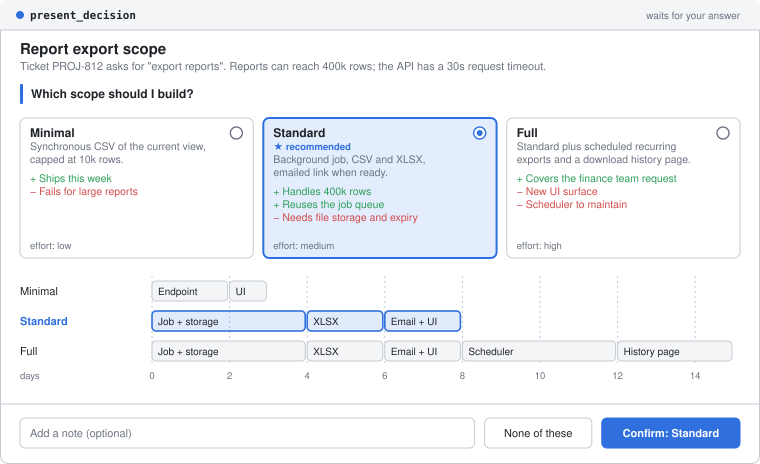

<details>
<summary>Chamada à ferramenta</summary>

```json
{
  "tool": "present_decision",
  "arguments": {
    "title": "Report export scope",
    "context": "Ticket PROJ-812 asks for \"export reports\". Reports can reach 400k rows; the API has a 30s request timeout.",
    "question": "Which scope should I build?",
    "blocks": [
      {
        "type": "cards",
        "id": "options",
        "items": [
          {
            "id": "minimal",
            "title": "Minimal",
            "summary": "Synchronous CSV of the current view, capped at 10k rows.",
            "pros": ["Ships this week"],
            "cons": ["Fails for large reports"],
            "effort": "low"
          },
          {
            "id": "standard",
            "title": "Standard",
            "summary": "Background job, CSV and XLSX, emailed link when ready.",
            "pros": ["Handles 400k rows","Reuses the job queue"],
            "cons": ["Needs file storage and expiry"],
            "effort": "medium",
            "recommended": true
          },
          {
            "id": "full",
            "title": "Full",
            "summary": "Standard plus scheduled recurring exports and a download history page.",
            "pros": ["Covers the finance team request"],
            "cons": ["New UI surface","Scheduler to maintain"],
            "effort": "high"
          }
        ]
      },
      {
        "type": "timeline",
        "unit": "days",
        "tracks": [
          {"id":"minimal","label":"Minimal","phases":[{"label":"Endpoint","duration":2},{"label":"UI","duration":1}]},
          {
            "id": "standard",
            "label": "Standard",
            "phases": [{"label":"Job + storage","duration":4},{"label":"XLSX","duration":2},{"label":"Email + UI","duration":2}]
          },
          {
            "id": "full",
            "label": "Full",
            "phases": [
              {"label":"Job + storage","duration":4},
              {"label":"XLSX","duration":2},
              {"label":"Email + UI","duration":2},
              {"label":"Scheduler","duration":4},
              {"label":"History page","duration":3}
            ]
          }
        ]
      }
    ],
    "response": {"type":"choose_one","of":"options"}
  }
}
```

</details>

<a id="3-migration-rollout"></a>

### 3. Plano de migração ou rollout

**Situação.** Sessões de usuário vão sair do Postgres para o Redis. A dúvida não é o destino, é o caminho: quanto risco e quanto tempo de convivência entre os dois.

**Por que visual.** Estratégias de rollout diferem em duração, sobreposição e ponto sem volta, tudo temporal.

**O que o agente mostra.** Cartões das estratégias e uma linha do tempo com as fases de cada uma, com o ponto sem volta marcado.

**Interação.** O cartão em foco destaca a trilha da estratégia.

| | |
|---|---|
| Ferramenta | `present_decision` |
| Componentes | `cards`, `timeline` |
| Mecanismos | estados (opções), destaque ligado |
| Resposta | `choose_one` por item |
| Fontes | leitura do código, métricas de sessões ativas |
| Ainda não implementado | nada |

**Mensagem de volta ao chat.**

```text
Decision on "Session store migration": go with "Dual-write, then cut over" (option id: dual).
```

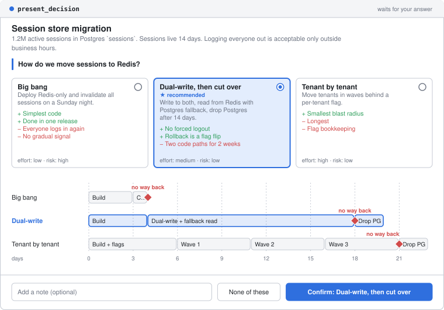

<details>
<summary>Chamada à ferramenta</summary>

```json
{
  "tool": "present_decision",
  "arguments": {
    "title": "Session store migration",
    "context": "1.2M active sessions in Postgres `sessions`. Sessions live 14 days. Logging everyone out is acceptable only outside business hours.",
    "question": "How do we move sessions to Redis?",
    "blocks": [
      {
        "type": "cards",
        "id": "options",
        "items": [
          {
            "id": "bigbang",
            "title": "Big bang",
            "summary": "Deploy Redis-only and invalidate all sessions on a Sunday night.",
            "pros": ["Simplest code","Done in one release"],
            "cons": ["Everyone logs in again","No gradual signal"],
            "effort": "low",
            "risk": "high"
          },
          {
            "id": "dual",
            "title": "Dual-write, then cut over",
            "summary": "Write to both, read from Redis with Postgres fallback, drop Postgres after 14 days.",
            "pros": ["No forced logout","Rollback is a flag flip"],
            "cons": ["Two code paths for 2 weeks"],
            "effort": "medium",
            "risk": "low",
            "recommended": true
          },
          {
            "id": "tenant",
            "title": "Tenant by tenant",
            "summary": "Move tenants in waves behind a per-tenant flag.",
            "pros": ["Smallest blast radius"],
            "cons": ["Longest","Flag bookkeeping"],
            "effort": "high",
            "risk": "low"
          }
        ]
      },
      {
        "type": "timeline",
        "unit": "days",
        "tracks": [
          {"id":"bigbang","label":"Big bang","phases":[{"label":"Build","duration":3},{"label":"Cut","duration":1}]},
          {
            "id": "dual",
            "label": "Dual-write",
            "phases": [
              {"label":"Build","duration":4},
              {"label":"Dual-write + fallback read","duration":14},
              {"label":"Drop PG","duration":2}
            ]
          },
          {
            "id": "tenant",
            "label": "Tenant by tenant",
            "phases": [
              {"label":"Build + flags","duration":6},
              {"label":"Wave 1","duration":5},
              {"label":"Wave 2","duration":5},
              {"label":"Wave 3","duration":5},
              {"label":"Drop PG","duration":2}
            ]
          }
        ],
        "events": [
          {"at":4,"track":"bigbang","label":"no way back","change":"removed"},
          {"at":18,"track":"dual","label":"no way back","change":"removed"},
          {"at":21,"track":"tenant","label":"no way back","change":"removed"}
        ]
      }
    ],
    "response": {"type":"choose_one","of":"options"}
  }
}
```

</details>

<a id="4-refactoring-strategy"></a>

### 4. Estratégia de refatoração

**Situação.** Uma classe `OrderService` de 2.400 linhas concentra preço, estoque e faturamento. O agente propõe formas de quebrá-la.

**Por que visual.** O que muda entre as estratégias é a forma final do grafo de dependências; mostrar o grafo com o que é adicionado e removido torna isso concreto.

**O que o agente mostra.** Cartões das estratégias e o grafo de módulos com marcadores de mudança, filtrado pela estratégia em foco.

**Interação.** Cada cartão é uma lente sobre o grafo: mostra os módulos novos e os que somem naquela estratégia.

| | |
|---|---|
| Ferramenta | `present_decision` |
| Componentes | `cards`, `graph` |
| Mecanismos | estados (opções), marcadores `change` |
| Resposta | `choose_one` por item |
| Fontes | leitura do código, grafo de imports |
| Ainda não implementado | nada |

**Mensagem de volta ao chat.**

```text
Decision on "Breaking up OrderService": go with "Extract by domain" (option id: domain).
```

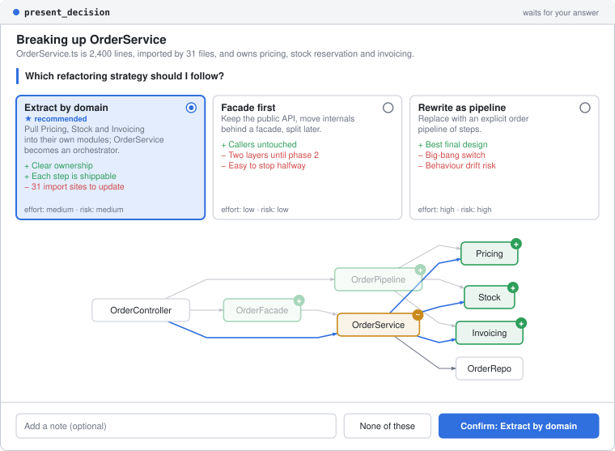

<details>
<summary>Chamada à ferramenta</summary>

```json
{
  "tool": "present_decision",
  "arguments": {
    "title": "Breaking up OrderService",
    "context": "OrderService.ts is 2,400 lines, imported by 31 files, and owns pricing, stock reservation and invoicing.",
    "question": "Which refactoring strategy should I follow?",
    "blocks": [
      {
        "type": "cards",
        "id": "options",
        "items": [
          {
            "id": "domain",
            "title": "Extract by domain",
            "summary": "Pull Pricing, Stock and Invoicing into their own modules; OrderService becomes an orchestrator.",
            "pros": ["Clear ownership","Each step is shippable"],
            "cons": ["31 import sites to update"],
            "effort": "medium",
            "risk": "medium",
            "recommended": true
          },
          {
            "id": "facade",
            "title": "Facade first",
            "summary": "Keep the public API, move internals behind a facade, split later.",
            "pros": ["Callers untouched"],
            "cons": ["Two layers until phase 2","Easy to stop halfway"],
            "effort": "low",
            "risk": "low"
          },
          {
            "id": "rewrite",
            "title": "Rewrite as pipeline",
            "summary": "Replace with an explicit order pipeline of steps.",
            "pros": ["Best final design"],
            "cons": ["Big-bang switch","Behaviour drift risk"],
            "effort": "high",
            "risk": "high"
          }
        ]
      },
      {
        "type": "graph",
        "direction": "LR",
        "nodes": [
          {"id":"ctrl","label":"OrderController"},
          {"id":"svc","label":"OrderService","change":"changed"},
          {"id":"order-facade","label":"OrderFacade","change":"added"},
          {
            "id": "pricing",
            "label": "Pricing",
            "change": "added",
            "emphasis": "faded",
            "when": {"domain":{"emphasis":"highlighted"},"rewrite":{"emphasis":"highlighted"}}
          },
          {
            "id": "stock",
            "label": "Stock",
            "change": "added",
            "emphasis": "faded",
            "when": {"domain":{"emphasis":"highlighted"},"rewrite":{"emphasis":"highlighted"}}
          },
          {
            "id": "invoice",
            "label": "Invoicing",
            "change": "added",
            "emphasis": "faded",
            "when": {"domain":{"emphasis":"highlighted"},"rewrite":{"emphasis":"highlighted"}}
          },
          {
            "id": "pipe",
            "label": "OrderPipeline",
            "change": "added",
            "emphasis": "faded",
            "when": {"rewrite":{"emphasis":"highlighted"}}
          },
          {"id":"repo","label":"OrderRepo"}
        ],
        "edges": [
          {"from":"ctrl","to":"svc","emphasis":"faded","when":{"domain":{"emphasis":"highlighted"}}},
          {"from":"ctrl","to":"order-facade","emphasis":"faded","when":{"facade":{"emphasis":"highlighted"}}},
          {"from":"order-facade","to":"svc","emphasis":"faded","when":{"facade":{"emphasis":"highlighted"}}},
          {"from":"ctrl","to":"pipe","emphasis":"faded","when":{"rewrite":{"emphasis":"highlighted"}}},
          {"from":"svc","to":"pricing","emphasis":"faded","when":{"domain":{"emphasis":"highlighted"}}},
          {"from":"svc","to":"stock","emphasis":"faded","when":{"domain":{"emphasis":"highlighted"}}},
          {"from":"svc","to":"invoice","emphasis":"faded","when":{"domain":{"emphasis":"highlighted"}}},
          {"from":"pipe","to":"pricing","emphasis":"faded","when":{"rewrite":{"emphasis":"highlighted"}}},
          {"from":"pipe","to":"stock","emphasis":"faded","when":{"rewrite":{"emphasis":"highlighted"}}},
          {"from":"pipe","to":"invoice","emphasis":"faded","when":{"rewrite":{"emphasis":"highlighted"}}},
          {"from":"svc","to":"repo"}
        ]
      }
    ],
    "response": {"type":"choose_one","of":"options"}
  }
}
```

</details>

<a id="5-decision-records"></a>

### 5. Registro de decisões (ADR)

**Situação.** No meio de uma tarefa, o usuário pergunta "por que mesmo escolhemos SSE?". O agente consulta o registro e mostra o histórico.

**Por que visual.** Decisões passadas são tabulares: quando, o que foi escolhido, o que foi descartado. Uma matriz é mais rápida de varrer do que uma lista em prosa.

**O que o agente mostra.** Uma matriz com uma linha por decisão registrada e a decisão em questão destacada.

**Interação.** Clicar numa linha envia ao chat uma pergunta sobre aquela decisão.

| | |
|---|---|
| Ferramenta | `present_view` |
| Componentes | `matrix` |
| Mecanismos | perguntar sobre isto, passo a passo |
| Resposta | nenhuma |
| Fontes | `list_decisions` (diorama) |
| Ainda não implementado | nada |

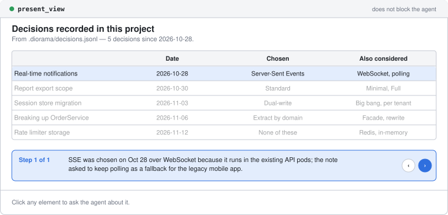

<details>
<summary>Chamada à ferramenta</summary>

```json
{
  "tool": "present_view",
  "arguments": {
    "title": "Decisions recorded in this project",
    "context": "From .diorama/decisions.jsonl — 5 decisions since 2026-10-28.",
    "blocks": [
      {
        "type": "matrix",
        "columns": [{"id":"date","label":"Date"},{"id":"chosen","label":"Chosen"},{"id":"considered","label":"Also considered"}],
        "rows": [
          {
            "id": "d1",
            "label": "Real-time notifications",
            "cells": ["2026-10-28","Server-Sent Events","WebSocket, polling"]
          },
          {"id":"d2","label":"Report export scope","cells":["2026-10-30","Standard","Minimal, Full"]},
          {"id":"d3","label":"Session store migration","cells":["2026-11-03","Dual-write","Big bang, per tenant"]},
          {"id":"d4","label":"Breaking up OrderService","cells":["2026-11-06","Extract by domain","Facade, rewrite"]},
          {"id":"d5","label":"Rate limiter storage","cells":["2026-11-12","None of these","Redis, in-memory"]}
        ]
      }
    ],
    "walkthrough": [
      {
        "text": "SSE was chosen on Oct 28 over WebSocket because it runs in the existing API pods; the note asked to keep polling as a fallback for the legacy mobile app.",
        "focus": ["d1"]
      }
    ]
  }
}
```

</details>

## Alinhar

O agente mostra o que entendeu antes de agir, para que o erro de entendimento seja pego cedo.

<a id="6-system-understanding"></a>

### 6. Confirmar o entendimento do sistema

**Situação.** Antes de mexer no checkout, o agente leu o código e montou um modelo de como ele funciona. Se o modelo estiver errado, tudo que vier depois estará errado.

**Por que visual.** O usuário corrige um diagrama em segundos; corrigir três parágrafos de descrição exige ler tudo.

**O que o agente mostra.** O grafo dos componentes como o agente os entendeu e a lista de suposições que ele está fazendo.

**Interação.** O passo a passo percorre as suposições e destaca no grafo os elementos a que cada uma se refere. O usuário aprova ou rejeita cada uma.

| | |
|---|---|
| Ferramenta | `present_decision` |
| Componentes | `graph`, `steps` |
| Mecanismos | passo a passo |
| Resposta | `approve` por item |
| Fontes | leitura do código |
| Ainda não implementado | nada |

**Mensagem de volta ao chat.**

```text
Review of "How checkout works today": approved a1, a2, a4; rejected a3.
Note: inventory is reserved AFTER payment authorisation, not before
```

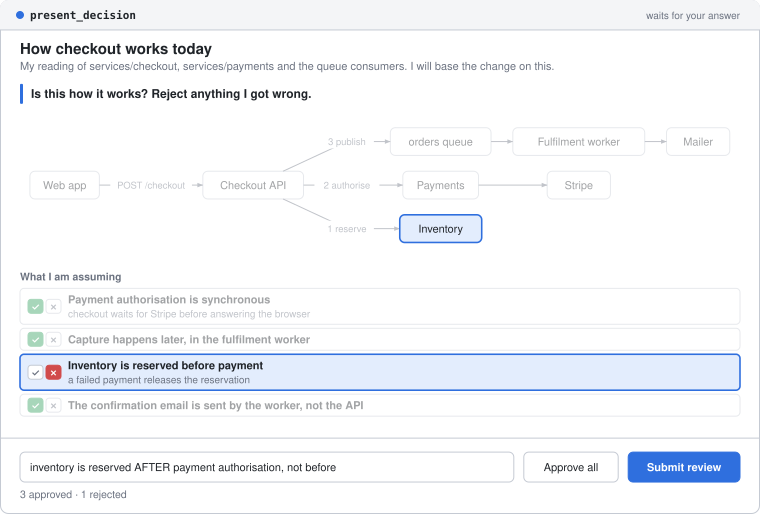

<details>
<summary>Chamada à ferramenta</summary>

```json
{
  "tool": "present_decision",
  "arguments": {
    "title": "How checkout works today",
    "context": "My reading of services/checkout, services/payments and the queue consumers. I will base the change on this.",
    "question": "Is this how it works? Reject anything I got wrong.",
    "blocks": [
      {
        "type": "graph",
        "direction": "LR",
        "nodes": [
          {"id":"web","label":"Web app"},
          {"id":"checkout","label":"Checkout API"},
          {"id":"inv","label":"Inventory"},
          {"id":"pay","label":"Payments"},
          {"id":"psp","label":"Stripe"},
          {"id":"q","label":"orders queue"},
          {"id":"ful","label":"Fulfilment worker"},
          {"id":"mail","label":"Mailer"}
        ],
        "edges": [
          {"from":"web","to":"checkout","label":"POST /checkout"},
          {"from":"checkout","to":"inv","label":"1 reserve"},
          {"from":"checkout","to":"pay","label":"2 authorise"},
          {"from":"pay","to":"psp"},
          {"from":"checkout","to":"q","label":"3 publish"},
          {"from":"q","to":"ful"},
          {"from":"ful","to":"mail"}
        ]
      },
      {
        "type": "steps",
        "id": "assumptions",
        "label": "What I am assuming",
        "numbered": false,
        "items": [
          {
            "id": "a1",
            "label": "Payment authorisation is synchronous",
            "detail": "checkout waits for Stripe before answering the browser"
          },
          {"id":"a2","label":"Capture happens later, in the fulfilment worker"},
          {
            "id": "a3",
            "label": "Inventory is reserved before payment",
            "detail": "a failed payment releases the reservation"
          },
          {"id":"a4","label":"The confirmation email is sent by the worker, not the API"}
        ]
      }
    ],
    "response": {"type":"approve","of":"assumptions"},
    "walkthrough": [
      {
        "text": "Payment authorisation is synchronous: checkout waits for Stripe before answering the browser.",
        "focus": ["a1","pay","psp"]
      },
      {"text":"Capture happens later, in the fulfilment worker.","focus":["a2","ful"]},
      {"text":"Inventory is reserved before payment: a failed payment releases the reservation.","focus":["a3","inv"]},
      {"text":"The confirmation email is sent by the worker, not the API.","focus":["a4","mail"]}
    ]
  }
}
```

</details>

<a id="7-entity-lifecycle"></a>

### 7. Ciclo de vida de uma entidade

**Situação.** O agente vai implementar pausa de assinatura e precisa do mapa de estados atual, incluindo os caminhos de cobrança falha.

**Por que visual.** Transições faltando ou estados sem saída são invisíveis em código espalhado e óbvios num diagrama de estados.

**O que o agente mostra.** A máquina de estados da assinatura, com lentes para cada jornada e a transição proposta marcada como adição.

**Interação.** Alternar a lente isola o caminho feliz, a cobrança falha ou o cancelamento.

| | |
|---|---|
| Ferramenta | `present_view` |
| Componentes | `graph` |
| Mecanismos | estados (lentes), marcadores `change` e `status`, perguntar sobre isto |
| Resposta | nenhuma |
| Fontes | leitura do código, enum de status no schema |
| Ainda não implementado | nada |

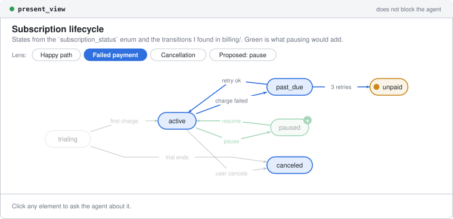

<details>
<summary>Chamada à ferramenta</summary>

```json
{
  "tool": "present_view",
  "arguments": {
    "title": "Subscription lifecycle",
    "context": "States from the `subscription_status` enum and the transitions I found in billing/. Green is what pausing would add.",
    "lenses": [
      {"id":"happy","label":"Happy path"},
      {"id":"dunning","label":"Failed payment"},
      {"id":"cancel","label":"Cancellation"},
      {"id":"pause","label":"Proposed: pause"}
    ],
    "blocks": [
      {
        "type": "graph",
        "variant": "state",
        "direction": "LR",
        "nodes": [
          {"id":"trial","label":"trialing","emphasis":"faded","when":{"happy":{"emphasis":"highlighted"}}},
          {
            "id": "active",
            "label": "active",
            "emphasis": "faded",
            "when": {
              "happy": {"emphasis":"highlighted"},
              "dunning": {"emphasis":"highlighted"},
              "cancel": {"emphasis":"highlighted"},
              "pause": {"emphasis":"highlighted"}
            }
          },
          {"id":"pastdue","label":"past_due","emphasis":"faded","when":{"dunning":{"emphasis":"highlighted"}}},
          {
            "id": "unpaid",
            "label": "unpaid",
            "status": "warn",
            "note": "No transition leaves this state",
            "emphasis": "faded",
            "when": {"dunning":{"emphasis":"highlighted"}}
          },
          {
            "id": "paused",
            "label": "paused",
            "change": "added",
            "emphasis": "faded",
            "when": {"pause":{"emphasis":"highlighted"}}
          },
          {
            "id": "canceled",
            "label": "canceled",
            "emphasis": "faded",
            "when": {"cancel":{"emphasis":"highlighted"},"dunning":{"emphasis":"highlighted"}}
          }
        ],
        "edges": [
          {
            "from": "trial",
            "to": "active",
            "label": "first charge",
            "emphasis": "faded",
            "when": {"happy":{"emphasis":"highlighted"}}
          },
          {
            "from": "active",
            "to": "pastdue",
            "label": "charge failed",
            "emphasis": "faded",
            "when": {"dunning":{"emphasis":"highlighted"}}
          },
          {
            "from": "pastdue",
            "to": "active",
            "label": "retry ok",
            "emphasis": "faded",
            "when": {"dunning":{"emphasis":"highlighted"}}
          },
          {
            "from": "pastdue",
            "to": "unpaid",
            "label": "3 retries",
            "emphasis": "faded",
            "when": {"dunning":{"emphasis":"highlighted"}}
          },
          {
            "from": "active",
            "to": "canceled",
            "label": "user cancels",
            "emphasis": "faded",
            "when": {"cancel":{"emphasis":"highlighted"}}
          },
          {
            "from": "trial",
            "to": "canceled",
            "label": "trial ends",
            "emphasis": "faded",
            "when": {"cancel":{"emphasis":"highlighted"}}
          },
          {
            "from": "active",
            "to": "paused",
            "label": "pause",
            "change": "added",
            "emphasis": "faded",
            "when": {"pause":{"emphasis":"highlighted"}}
          },
          {
            "from": "paused",
            "to": "active",
            "label": "resume",
            "change": "added",
            "emphasis": "faded",
            "when": {"pause":{"emphasis":"highlighted"}}
          }
        ]
      }
    ]
  }
}
```

</details>

<a id="8-data-model-change"></a>

### 8. Modelagem de dados e mudança de schema

**Situação.** O produto vai passar de contas individuais para organizações com vários membros. O agente propõe o novo modelo e as migrações.

**Por que visual.** Um diagrama de entidades com o diff marcado mostra de uma vez o que nasce, o que muda e que relações passam a existir.

**O que o agente mostra.** As entidades com campos adicionados e alterados, e a sequência de migrações para aprovar uma a uma.

**Interação.** O passo a passo percorre as migrações e destaca as tabelas que cada uma toca.

| | |
|---|---|
| Ferramenta | `present_decision` |
| Componentes | `graph`, `steps` |
| Mecanismos | marcadores `change`, passo a passo |
| Resposta | `approve` por item |
| Fontes | schema atual, leitura dos models |
| Ainda não implementado | nada |

**Mensagem de volta ao chat.**

```text
Review of "Organisations data model": approved m1, m2, m3; rejected m4.
Note: keep projects.owner_id for one release
```

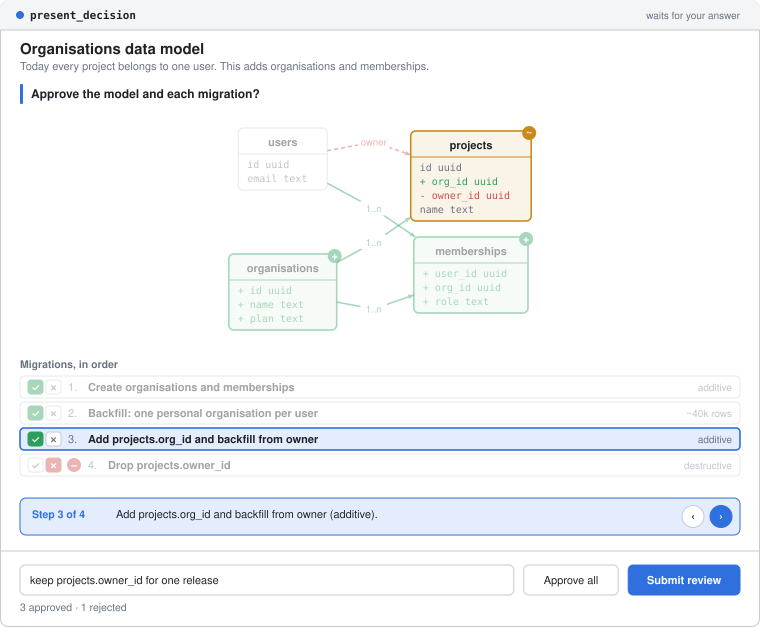

<details>
<summary>Chamada à ferramenta</summary>

```json
{
  "tool": "present_decision",
  "arguments": {
    "title": "Organisations data model",
    "context": "Today every project belongs to one user. This adds organisations and memberships.",
    "question": "Approve the model and each migration?",
    "blocks": [
      {
        "type": "graph",
        "variant": "entity",
        "direction": "LR",
        "nodes": [
          {"id":"users","label":"users","fields":["id uuid","email text"]},
          {"id":"orgs","label":"organisations","change":"added","fields":["+ id uuid","+ name text","+ plan text"]},
          {
            "id": "members",
            "label": "memberships",
            "change": "added",
            "fields": ["+ user_id uuid","+ org_id uuid","+ role text"]
          },
          {
            "id": "projects",
            "label": "projects",
            "change": "changed",
            "fields": ["id uuid","+ org_id uuid","- owner_id uuid","name text"]
          }
        ],
        "edges": [
          {"from":"users","to":"members","label":"1..n","change":"added"},
          {"from":"orgs","to":"members","label":"1..n","change":"added"},
          {"from":"orgs","to":"projects","label":"1..n","change":"added"},
          {"from":"users","to":"projects","label":"owner","change":"removed"}
        ]
      },
      {
        "type": "steps",
        "id": "migrations",
        "label": "Migrations, in order",
        "items": [
          {"id":"m1","label":"Create organisations and memberships","meta":"additive"},
          {"id":"m2","label":"Backfill: one personal organisation per user","meta":"~40k rows"},
          {"id":"m3","label":"Add projects.org_id and backfill from owner","meta":"additive"},
          {"id":"m4","label":"Drop projects.owner_id","meta":"destructive","change":"removed"}
        ]
      }
    ],
    "response": {"type":"approve","of":"migrations"},
    "walkthrough": [
      {"text":"Create organisations and memberships (additive).","focus":["m1","orgs","members"]},
      {"text":"Backfill: one personal organisation per user (~40k rows).","focus":["m2","orgs","members","users"]},
      {"text":"Add projects.org_id and backfill from owner (additive).","focus":["m3","projects"]},
      {"text":"Drop projects.owner_id (destructive).","focus":["m4","projects"]}
    ]
  }
}
```

</details>

<a id="9-api-contract"></a>

### 9. Contrato de API e interação entre serviços

**Situação.** O agente vai integrar um novo provedor de pagamento e precisa alinhar a ordem das chamadas entre cliente, API e provedor, incluindo o caso de recusa.

**Por que visual.** Ordem e direção de mensagens entre vários atores é exatamente o que um diagrama de sequência representa.

**O que o agente mostra.** Um diagrama de sequência com lentes para o caminho de sucesso e o de pagamento recusado.

**Interação.** Alternar a lente mostra quais mensagens existem em cada caminho.

| | |
|---|---|
| Ferramenta | `present_view` |
| Componentes | `sequence` |
| Mecanismos | estados (lentes), perguntar sobre isto |
| Resposta | nenhuma |
| Fontes | docs do provedor, leitura do código |
| Ainda não implementado | nada |

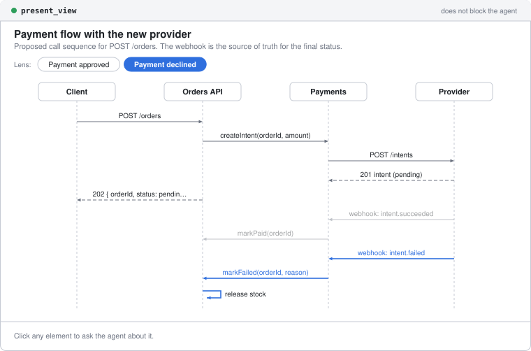

<details>
<summary>Chamada à ferramenta</summary>

```json
{
  "tool": "present_view",
  "arguments": {
    "title": "Payment flow with the new provider",
    "context": "Proposed call sequence for POST /orders. The webhook is the source of truth for the final status.",
    "lenses": [{"id":"ok","label":"Payment approved"},{"id":"declined","label":"Payment declined"}],
    "blocks": [
      {
        "type": "sequence",
        "actors": [
          {"id":"client","label":"Client"},
          {"id":"api","label":"Orders API"},
          {"id":"pay","label":"Payments"},
          {"id":"psp","label":"Provider"}
        ],
        "messages": [
          {"from":"client","to":"api","label":"POST /orders"},
          {"from":"api","to":"pay","label":"createIntent(orderId, amount)"},
          {"from":"pay","to":"psp","label":"POST /intents"},
          {"from":"psp","to":"pay","label":"201 intent (pending)","reply":true},
          {"from":"api","to":"client","label":"202 { orderId, status: pending }","reply":true},
          {
            "from": "psp",
            "to": "pay",
            "label": "webhook: intent.succeeded",
            "emphasis": "faded",
            "when": {"ok":{"emphasis":"highlighted"}}
          },
          {
            "from": "pay",
            "to": "api",
            "label": "markPaid(orderId)",
            "emphasis": "faded",
            "when": {"ok":{"emphasis":"highlighted"}}
          },
          {
            "from": "psp",
            "to": "pay",
            "label": "webhook: intent.failed",
            "emphasis": "faded",
            "when": {"declined":{"emphasis":"highlighted"}}
          },
          {
            "from": "pay",
            "to": "api",
            "label": "markFailed(orderId, reason)",
            "emphasis": "faded",
            "when": {"declined":{"emphasis":"highlighted"}}
          },
          {
            "from": "api",
            "to": "api",
            "label": "release stock",
            "emphasis": "faded",
            "when": {"declined":{"emphasis":"highlighted"}}
          }
        ]
      }
    ]
  }
}
```

</details>

## Aprovar

O agente já sabe o que quer fazer e pede autorização, no todo ou por item.

<a id="10-implementation-plan"></a>

### 10. Plano de implementação

**Situação.** Antes de escrever código para uma mudança de vários arquivos, o agente apresenta o plano.

**Por que visual.** O usuário quer cortar ou vetar passos específicos sem reescrever o plano. Uma lista com veredito por item faz isso com um clique por passo.

**O que o agente mostra.** Os passos na ordem de execução, com os arquivos de cada um.

**Interação.** Aprovar ou rejeitar cada passo; a nota explica a rejeição.

| | |
|---|---|
| Ferramenta | `present_decision` |
| Componentes | `steps` |
| Mecanismos | resposta `approve` por item |
| Resposta | `approve` por item |
| Fontes | leitura do código |
| Ainda não implementado | nada |

**Mensagem de volta ao chat.**

```text
Review of "Rate limiting on the public API": approved s1, s2, s3, s5, s6; rejected s4.
Note: no admin UI for now, config file is enough
```

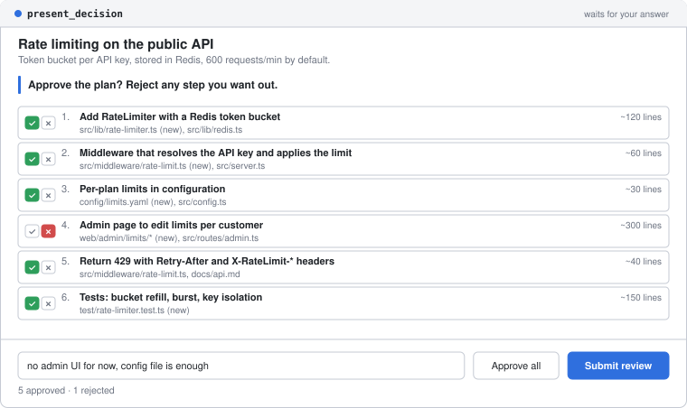

<details>
<summary>Chamada à ferramenta</summary>

```json
{
  "tool": "present_decision",
  "arguments": {
    "title": "Rate limiting on the public API",
    "context": "Token bucket per API key, stored in Redis, 600 requests/min by default.",
    "question": "Approve the plan? Reject any step you want out.",
    "blocks": [
      {
        "type": "steps",
        "id": "plan",
        "items": [
          {
            "id": "s1",
            "label": "Add RateLimiter with a Redis token bucket",
            "detail": "src/lib/rate-limiter.ts (new), src/lib/redis.ts",
            "meta": "~120 lines"
          },
          {
            "id": "s2",
            "label": "Middleware that resolves the API key and applies the limit",
            "detail": "src/middleware/rate-limit.ts (new), src/server.ts",
            "meta": "~60 lines"
          },
          {
            "id": "s3",
            "label": "Per-plan limits in configuration",
            "detail": "config/limits.yaml (new), src/config.ts",
            "meta": "~30 lines"
          },
          {
            "id": "s4",
            "label": "Admin page to edit limits per customer",
            "detail": "web/admin/limits/* (new), src/routes/admin.ts",
            "meta": "~300 lines"
          },
          {
            "id": "s5",
            "label": "Return 429 with Retry-After and X-RateLimit-* headers",
            "detail": "src/middleware/rate-limit.ts, docs/api.md",
            "meta": "~40 lines"
          },
          {
            "id": "s6",
            "label": "Tests: bucket refill, burst, key isolation",
            "detail": "test/rate-limiter.test.ts (new)",
            "meta": "~150 lines"
          }
        ]
      }
    ],
    "response": {"type":"approve","of":"plan"}
  }
}
```

</details>

<a id="11-blast-radius"></a>

### 11. Impacto de uma mudança (blast radius)

**Situação.** O usuário pediu para renomear um campo. O agente descobre que a mudança atravessa API pública, eventos e um job de exportação.

**Por que visual.** "Afeta 14 arquivos" não diz nada; ver quais módulos mudam e quais são afetados indiretamente mostra o risco real.

**O que o agente mostra.** O grafo de módulos com o que muda e o que é afetado, e a árvore dos arquivos tocados.

**Interação.** Cada arquivo tem o id do módulo a que pertence: focar um módulo destaca o arquivo dele na árvore, e vice-versa.

| | |
|---|---|
| Ferramenta | `present_decision` |
| Componentes | `graph`, `tree` |
| Mecanismos | marcadores `change`, destaque ligado |
| Resposta | `approve` no todo |
| Fontes | busca por referências, grafo de imports |
| Ainda não implementado | nada |

**Mensagem de volta ao chat.**

```text
Approved "Renaming User.email to primaryEmail".
Note: keep `email` in the public API response as a deprecated alias
```

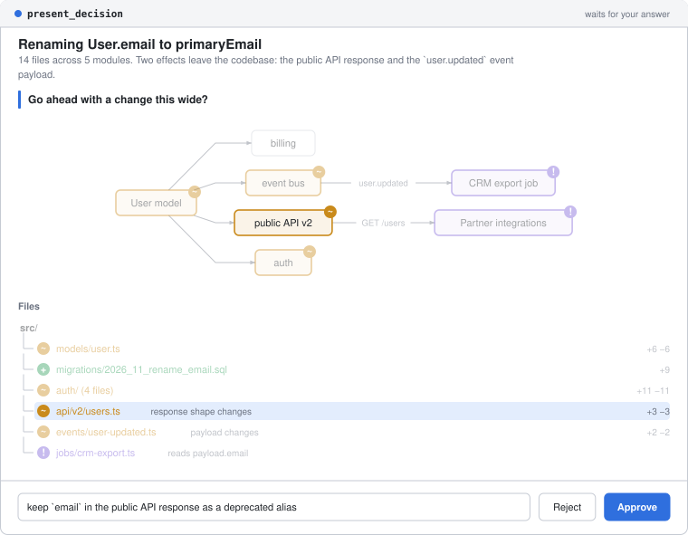

<details>
<summary>Chamada à ferramenta</summary>

```json
{
  "tool": "present_decision",
  "arguments": {
    "title": "Renaming User.email to primaryEmail",
    "context": "14 files across 5 modules. Two effects leave the codebase: the public API response and the `user.updated` event payload.",
    "question": "Go ahead with a change this wide?",
    "blocks": [
      {
        "type": "graph",
        "direction": "LR",
        "nodes": [
          {"id":"model","label":"User model","change":"changed"},
          {"id":"auth","label":"auth","change":"changed"},
          {"id":"api","label":"public API v2","change":"changed"},
          {"id":"events","label":"event bus","change":"changed"},
          {"id":"export","label":"CRM export job","change":"affected"},
          {"id":"partners","label":"Partner integrations","change":"affected"},
          {"id":"billing","label":"billing"}
        ],
        "edges": [
          {"from":"model","to":"auth"},
          {"from":"model","to":"api"},
          {"from":"model","to":"events"},
          {"from":"events","to":"export","label":"user.updated"},
          {"from":"api","to":"partners","label":"GET /users"},
          {"from":"model","to":"billing"}
        ]
      },
      {
        "type": "tree",
        "label": "Files",
        "nodes": [
          {"id":"root","label":"src/"},
          {"id":"model","label":"models/user.ts","change":"changed","meta":"+6 −6","parent":"root"},
          {"id":"f-mig","label":"migrations/2026_11_rename_email.sql","change":"added","meta":"+9","parent":"root"},
          {"id":"auth","label":"auth/ (4 files)","change":"changed","meta":"+11 −11","parent":"root"},
          {
            "id": "api",
            "label": "api/v2/users.ts",
            "change": "changed",
            "meta": "+3 −3",
            "note": "response shape changes",
            "parent": "root"
          },
          {
            "id": "events",
            "label": "events/user-updated.ts",
            "change": "changed",
            "meta": "+2 −2",
            "note": "payload changes",
            "parent": "root"
          },
          {
            "id": "export",
            "label": "jobs/crm-export.ts",
            "change": "affected",
            "note": "reads payload.email",
            "parent": "root"
          }
        ]
      }
    ],
    "response": {"type":"approve"}
  }
}
```

</details>

<a id="12-pr-summary"></a>

### 12. Resumo de um PR agrupado por intenção

**Situação.** O agente terminou uma tarefa longa e o diff tem 23 arquivos. O usuário precisa revisar sem se perder na ordem alfabética.

**Por que visual.** Agrupar arquivos pelo propósito da mudança transforma um diff plano numa explicação; a árvore dá a hierarquia intenção → arquivo.

**O que o agente mostra.** Uma árvore com um grupo por intenção e os arquivos de cada grupo, com tipo de mudança e tamanho.

**Interação.** Aprovar ou rejeitar por grupo; clicar num arquivo pergunta ao agente sobre ele.

| | |
|---|---|
| Ferramenta | `present_decision` |
| Componentes | `tree` |
| Mecanismos | marcadores `change`, resposta `approve` por item, perguntar sobre isto |
| Resposta | `approve` por item |
| Fontes | `git diff`, MCP do GitHub/GitLab |
| Ainda não implementado | nada |

**Mensagem de volta ao chat.**

```text
Review of "PR #482 — Rate limiting on the public API": approved g1, g2, g4; rejected g3.
Note: move the logging cleanup to its own PR
```

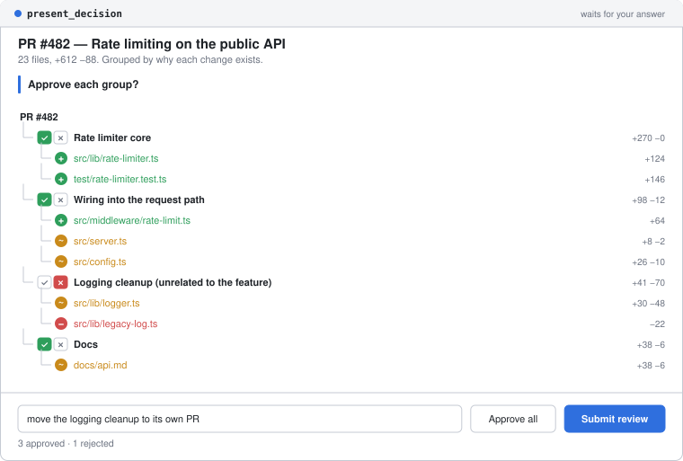

<details>
<summary>Chamada à ferramenta</summary>

```json
{
  "tool": "present_decision",
  "arguments": {
    "title": "PR #482 — Rate limiting on the public API",
    "context": "23 files, +612 −88. Grouped by why each change exists.",
    "question": "Approve each group?",
    "blocks": [
      {
        "type": "tree",
        "id": "groups",
        "nodes": [
          {"id":"pr","label":"PR #482"},
          {"id":"g1","label":"Rate limiter core","meta":"+270 −0","parent":"pr"},
          {"id":"g1a","label":"src/lib/rate-limiter.ts","change":"added","meta":"+124","parent":"g1"},
          {"id":"g1b","label":"test/rate-limiter.test.ts","change":"added","meta":"+146","parent":"g1"},
          {"id":"g2","label":"Wiring into the request path","meta":"+98 −12","parent":"pr"},
          {"id":"g2a","label":"src/middleware/rate-limit.ts","change":"added","meta":"+64","parent":"g2"},
          {"id":"g2b","label":"src/server.ts","change":"changed","meta":"+8 −2","parent":"g2"},
          {"id":"g2c","label":"src/config.ts","change":"changed","meta":"+26 −10","parent":"g2"},
          {"id":"g3","label":"Logging cleanup (unrelated to the feature)","meta":"+41 −70","parent":"pr"},
          {"id":"g3a","label":"src/lib/logger.ts","change":"changed","meta":"+30 −48","parent":"g3"},
          {"id":"g3b","label":"src/lib/legacy-log.ts","change":"removed","meta":"−22","parent":"g3"},
          {"id":"g4","label":"Docs","meta":"+38 −6","parent":"pr"},
          {"id":"g4a","label":"docs/api.md","change":"changed","meta":"+38 −6","parent":"g4"}
        ]
      }
    ],
    "response": {"type":"approve","of":"groups","depth":1}
  }
}
```

</details>

## Priorizar

Há mais itens do que capacidade. O usuário escolhe o que entra.

<a id="13-backlog-prioritisation"></a>

### 13. Priorização de backlog ou dívida técnica

**Situação.** O agente auditou o repositório e encontrou nove itens de dívida técnica. Há tempo para três ou quatro neste ciclo.

**Por que visual.** Impacto contra esforço é uma leitura espacial: o quadrante "alto impacto, baixo esforço" salta aos olhos.

**O que o agente mostra.** Os itens posicionados em impacto × esforço.

**Interação.** Marcar os itens que entram no ciclo.

| | |
|---|---|
| Ferramenta | `present_decision` |
| Componentes | `quadrant` |
| Mecanismos | resposta `choose_many` |
| Resposta | `choose_many` por item |
| Fontes | auditoria do código, histórico de incidentes |
| Ainda não implementado | nada |

**Mensagem de volta ao chat.**

```text
Selection for "Tech debt for this cycle": t1, t3, t6. Not selected: t2, t4, t5, t7, t8, t9.
```

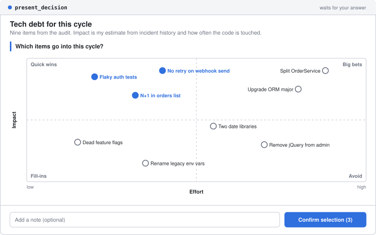

<details>
<summary>Chamada à ferramenta</summary>

```json
{
  "tool": "present_decision",
  "arguments": {
    "title": "Tech debt for this cycle",
    "context": "Nine items from the audit. Impact is my estimate from incident history and how often the code is touched.",
    "question": "Which items go into this cycle?",
    "blocks": [
      {
        "type": "quadrant",
        "id": "debt",
        "x": {"label":"Effort","low":"low","high":"high"},
        "y": {"label":"Impact"},
        "quadrants": ["Quick wins","Big bets","Fill-ins","Avoid"],
        "items": [
          {"id":"t1","label":"Flaky auth tests","x":2,"y":8.5},
          {"id":"t2","label":"Upgrade ORM major","x":8,"y":7.5},
          {"id":"t3","label":"N+1 in orders list","x":3.2,"y":7},
          {"id":"t4","label":"Remove jQuery from admin","x":7,"y":3},
          {"id":"t5","label":"Dead feature flags","x":1.5,"y":3.2},
          {"id":"t6","label":"No retry on webhook send","x":4,"y":9},
          {"id":"t7","label":"Split OrderService","x":8.8,"y":9},
          {"id":"t8","label":"Rename legacy env vars","x":3.5,"y":1.5},
          {"id":"t9","label":"Two date libraries","x":5.5,"y":4.5}
        ]
      }
    ],
    "response": {"type":"choose_many","of":"debt"}
  }
}
```

</details>

<a id="14-scope-cut-line"></a>

### 14. Linha de corte de escopo

**Situação.** A lista de itens de uma entrega soma mais do que o prazo comporta. O agente ordena por valor e pede ao usuário que decida o que entra.

**Por que visual.** Cortar escopo é marcar itens olhando o custo acumulado; uma lista com custo por linha e total em tempo real resolve.

**O que o agente mostra.** Os itens ordenados por valor, com o custo de cada um e o total selecionado contra o orçamento.

**Interação.** Marcar e desmarcar itens; o total acompanha.

| | |
|---|---|
| Ferramenta | `present_decision` |
| Componentes | `steps` |
| Mecanismos | resposta `choose_many` |
| Resposta | `choose_many` por item |
| Fontes | tickets do épico |
| Ainda não implementado | nada |

**Mensagem de volta ao chat.**

```text
Selection for "Onboarding revamp — what fits in 15 points": i1, i2, i3, i5. Not selected: i4, i6, i7.
```

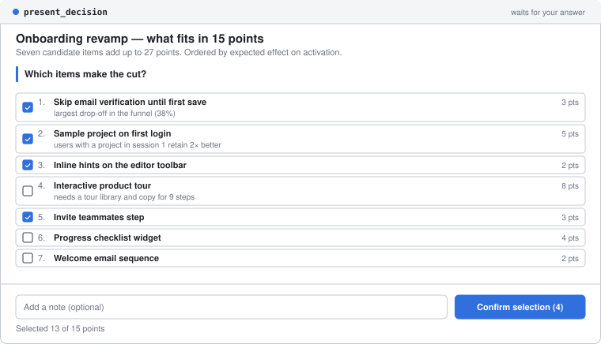

<details>
<summary>Chamada à ferramenta</summary>

```json
{
  "tool": "present_decision",
  "arguments": {
    "title": "Onboarding revamp — what fits in 15 points",
    "context": "Seven candidate items add up to 27 points. Ordered by expected effect on activation.",
    "question": "Which items make the cut?",
    "blocks": [
      {
        "type": "steps",
        "id": "items",
        "items": [
          {
            "id": "i1",
            "label": "Skip email verification until first save",
            "detail": "largest drop-off in the funnel (38%)",
            "meta": "3 pts"
          },
          {
            "id": "i2",
            "label": "Sample project on first login",
            "detail": "users with a project in session 1 retain 2× better",
            "meta": "5 pts"
          },
          {"id":"i3","label":"Inline hints on the editor toolbar","meta":"2 pts"},
          {
            "id": "i4",
            "label": "Interactive product tour",
            "detail": "needs a tour library and copy for 9 steps",
            "meta": "8 pts"
          },
          {"id":"i5","label":"Invite teammates step","meta":"3 pts"},
          {"id":"i6","label":"Progress checklist widget","meta":"4 pts"},
          {"id":"i7","label":"Welcome email sequence","meta":"2 pts"}
        ]
      }
    ],
    "response": {"type":"choose_many","of":"items"}
  }
}
```

</details>

<a id="15-risk-assessment"></a>

### 15. Riscos e mitigações

**Situação.** Antes de um lançamento, o agente levanta os riscos e propõe mitigações. O usuário decide quais tratar antes de ir para produção.

**Por que visual.** A matriz probabilidade × impacto é uma convenção conhecida; ligada à lista de mitigações, mostra o que cada ação tira da zona vermelha.

**O que o agente mostra.** A matriz de risco com os riscos posicionados e a lista de riscos com a mitigação proposta.

**Interação.** A célula e o item da lista têm o mesmo id: focar um risco destaca a célula dele na matriz.

| | |
|---|---|
| Ferramenta | `present_decision` |
| Componentes | `matrix`, `steps` |
| Mecanismos | destaque ligado, resposta `choose_many` |
| Resposta | `choose_many` por item |
| Fontes | leitura do código, plano de rollout |
| Ainda não implementado | nada |

**Mensagem de volta ao chat.**

```text
Selection for "Launch risks — multi-tenant release": r1, r2, r4. Not selected: r3, r5.
```

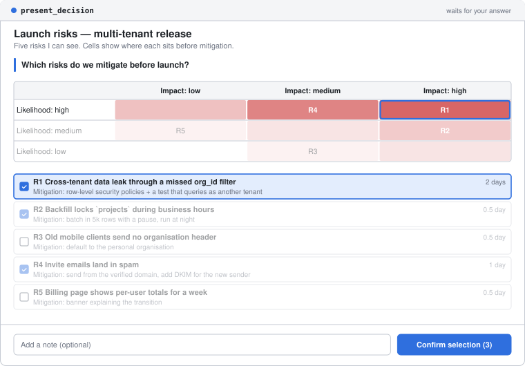

<details>
<summary>Chamada à ferramenta</summary>

```json
{
  "tool": "present_decision",
  "arguments": {
    "title": "Launch risks — multi-tenant release",
    "context": "Five risks I can see. Cells show where each sits before mitigation.",
    "question": "Which risks do we mitigate before launch?",
    "blocks": [
      {
        "type": "matrix",
        "columns": [
          {"id":"low","label":"Impact: low"},
          {"id":"med","label":"Impact: medium"},
          {"id":"high","label":"Impact: high"}
        ],
        "rows": [
          {
            "id": "p-high",
            "label": "Likelihood: high",
            "cells": [{"v":"","heat":2},{"id":"r4","v":"R4","heat":4},{"id":"r1","v":"R1","heat":5}]
          },
          {
            "id": "p-med",
            "label": "Likelihood: medium",
            "cells": [{"id":"r5","v":"R5","heat":1},{"v":"","heat":2},{"id":"r2","v":"R2","heat":4}]
          },
          {
            "id": "p-low",
            "label": "Likelihood: low",
            "cells": [{"v":"","heat":0},{"id":"r3","v":"R3","heat":1},{"v":"","heat":2}]
          }
        ]
      },
      {
        "type": "steps",
        "id": "risks",
        "numbered": false,
        "items": [
          {
            "id": "r1",
            "label": "R1  Cross-tenant data leak through a missed org_id filter",
            "detail": "Mitigation: row-level security policies + a test that queries as another tenant",
            "meta": "2 days"
          },
          {
            "id": "r2",
            "label": "R2  Backfill locks `projects` during business hours",
            "detail": "Mitigation: batch in 5k rows with a pause, run at night",
            "meta": "0.5 day"
          },
          {
            "id": "r3",
            "label": "R3  Old mobile clients send no organisation header",
            "detail": "Mitigation: default to the personal organisation",
            "meta": "0.5 day"
          },
          {
            "id": "r4",
            "label": "R4  Invite emails land in spam",
            "detail": "Mitigation: send from the verified domain, add DKIM for the new sender",
            "meta": "1 day"
          },
          {
            "id": "r5",
            "label": "R5  Billing page shows per-user totals for a week",
            "detail": "Mitigation: banner explaining the transition",
            "meta": "0.5 day"
          }
        ]
      }
    ],
    "response": {"type":"choose_many","of":"risks"}
  }
}
```

</details>

## Diagnosticar

O agente investigou e apresenta hipóteses, evidências ou medições.

<a id="16-bug-hypotheses"></a>

### 16. Hipóteses de um bug

**Situação.** Um erro intermitente em produção. O agente tem quatro hipóteses, cada uma com evidências a favor e contra e um custo para testar.

**Por que visual.** Diagnóstico é uma árvore: sintoma, hipóteses, evidências. Ver a árvore inteira evita que o agente siga a primeira ideia sem o usuário perceber as outras.

**O que o agente mostra.** A árvore sintoma → hipóteses → evidências, com a probabilidade estimada e o custo do teste de cada hipótese.

**Interação.** Escolher qual hipótese investigar primeiro.

| | |
|---|---|
| Ferramenta | `present_decision` |
| Componentes | `tree` |
| Mecanismos | marcadores `status`, perguntar sobre isto |
| Resposta | `choose_one` por item |
| Fontes | logs (MCP do ELK), métricas (MCP do Grafana), leitura do código |
| Ainda não implementado | nada |

**Mensagem de volta ao chat.**

```text
Decision on "Intermittent 502 on /api/reports": go with "Connection pool exhausted by the export job" (option id: h2).
```

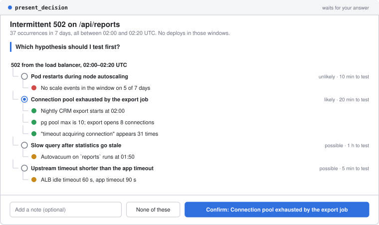

<details>
<summary>Chamada à ferramenta</summary>

```json
{
  "tool": "present_decision",
  "arguments": {
    "title": "Intermittent 502 on /api/reports",
    "context": "37 occurrences in 7 days, all between 02:00 and 02:20 UTC. No deploys in those windows.",
    "question": "Which hypothesis should I test first?",
    "blocks": [
      {
        "type": "tree",
        "id": "hyp",
        "nodes": [
          {"id":"sym","label":"502 from the load balancer, 02:00–02:20 UTC"},
          {"id":"h1","label":"Pod restarts during node autoscaling","meta":"unlikely · 10 min to test","parent":"sym"},
          {"id":"h1a","label":"No scale events in the window on 5 of 7 days","status":"failed","parent":"h1"},
          {
            "id": "h2",
            "label": "Connection pool exhausted by the export job",
            "meta": "likely · 20 min to test",
            "parent": "sym"
          },
          {"id":"h2a","label":"Nightly CRM export starts at 02:00","status":"ok","parent":"h2"},
          {"id":"h2b","label":"pg pool max is 10; export opens 8 connections","status":"ok","parent":"h2"},
          {"id":"h2c","label":"\"timeout acquiring connection\" appears 31 times","status":"ok","parent":"h2"},
          {"id":"h3","label":"Slow query after statistics go stale","meta":"possible · 1 h to test","parent":"sym"},
          {"id":"h3a","label":"Autovacuum on `reports` runs at 01:50","status":"warn","parent":"h3"},
          {
            "id": "h4",
            "label": "Upstream timeout shorter than the app timeout",
            "meta": "possible · 5 min to test",
            "parent": "sym"
          },
          {"id":"h4a","label":"ALB idle timeout 60 s, app timeout 90 s","status":"warn","parent":"h4"}
        ]
      }
    ],
    "response": {"type":"choose_one","of":"hyp","depth":1}
  }
}
```

</details>

<a id="17-incident-timeline"></a>

### 17. Linha do tempo de um incidente

**Situação.** Depois de um incidente, o agente correlaciona logs, deploys e alertas de vários serviços para reconstruir o que aconteceu.

**Por que visual.** Causalidade num incidente é ordem no tempo entre serviços. Raias por serviço na mesma escala mostram o que veio antes de quê.

**O que o agente mostra.** Uma raia por serviço com os períodos degradados e os eventos (deploy, alerta, rollback), narrados passo a passo.

**Interação.** Avançar os passos da narrativa destaca os trechos relevantes; clicar num evento pergunta sobre ele.

| | |
|---|---|
| Ferramenta | `present_view` |
| Componentes | `timeline` |
| Mecanismos | passo a passo, marcadores `status`, perguntar sobre isto |
| Resposta | nenhuma |
| Fontes | logs (MCP do ELK), alertas (MCP do Grafana), histórico de deploys |
| Ainda não implementado | nada |

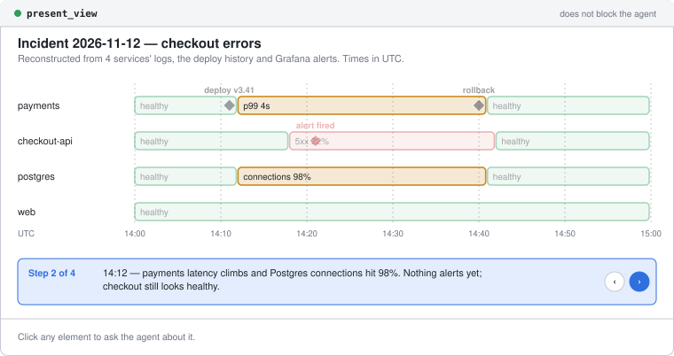

<details>
<summary>Chamada à ferramenta</summary>

```json
{
  "tool": "present_view",
  "arguments": {
    "title": "Incident 2026-11-12 — checkout errors",
    "context": "Reconstructed from 4 services' logs, the deploy history and Grafana alerts. Times in UTC.",
    "blocks": [
      {
        "type": "timeline",
        "unit": "UTC",
        "end": 60,
        "ticks": [
          {"at":0,"label":"14:00"},
          {"at":10,"label":"14:10"},
          {"at":20,"label":"14:20"},
          {"at":30,"label":"14:30"},
          {"at":40,"label":"14:40"},
          {"at":50,"label":"14:50"},
          {"at":60,"label":"15:00"}
        ],
        "tracks": [
          {
            "id": "payments",
            "label": "payments",
            "phases": [
              {"id":"p-ok","label":"healthy","start":0,"duration":12,"status":"ok"},
              {"id":"p-slow","label":"p99 4s","start":12,"duration":29,"status":"warn"},
              {"id":"p-ok2","label":"healthy","start":41,"duration":19,"status":"ok"}
            ]
          },
          {
            "id": "checkout",
            "label": "checkout-api",
            "phases": [
              {"id":"c-ok","label":"healthy","start":0,"duration":18,"status":"ok"},
              {"id":"c-err","label":"5xx 22%","start":18,"duration":24,"status":"failed"},
              {"id":"c-ok2","label":"healthy","start":42,"duration":18,"status":"ok"}
            ]
          },
          {
            "id": "db",
            "label": "postgres",
            "phases": [
              {"id":"d-ok","label":"healthy","start":0,"duration":12,"status":"ok"},
              {"id":"d-conn","label":"connections 98%","start":12,"duration":29,"status":"warn"},
              {"id":"d-ok2","label":"healthy","start":41,"duration":19,"status":"ok"}
            ]
          },
          {"id":"web","label":"web","phases":[{"id":"w-ok","label":"healthy","start":0,"duration":60,"status":"ok"}]}
        ],
        "events": [
          {"id":"e-deploy","at":11,"track":"payments","label":"deploy v3.41"},
          {"id":"e-alert","at":21,"track":"checkout","label":"alert fired","status":"failed"},
          {"id":"e-rollback","at":40,"track":"payments","label":"rollback"}
        ]
      }
    ],
    "walkthrough": [
      {
        "text": "14:11 — payments v3.41 is deployed. It adds a retry loop that opens a new DB connection per attempt.",
        "focus": ["e-deploy","p-ok","d-ok"]
      },
      {
        "text": "14:12 — payments latency climbs and Postgres connections hit 98%. Nothing alerts yet; checkout still looks healthy.",
        "focus": ["p-slow","d-conn"]
      },
      {
        "text": "14:18 — checkout starts timing out on payment calls; the alert fires three minutes later.",
        "focus": ["c-err","e-alert"]
      },
      {
        "text": "14:40 — rollback of payments; both services recover within two minutes.",
        "focus": ["e-rollback","p-ok2","c-ok2","d-ok2"]
      }
    ]
  }
}
```

</details>

<a id="18-log-error-heatmap"></a>

### 18. Padrão de erros nos logs

**Situação.** O usuário pede "dá uma olhada nos erros de hoje". O agente consulta os logs e encontra um agrupamento que não aparece lendo linha a linha.

**Por que visual.** Um mapa de calor serviço × tempo revela concentração e propagação; a lista de evidências ancora a leitura em linhas de log reais.

**O que o agente mostra.** O mapa de calor de erros por serviço e janela de tempo, e as evidências que sustentam a conclusão do agente.

**Interação.** Cada evidência tem o id do serviço de que fala: focar uma destaca a linha do serviço; clicar numa célula pergunta sobre aquele intervalo.

| | |
|---|---|
| Ferramenta | `present_view` |
| Componentes | `matrix`, `steps` |
| Mecanismos | destaque ligado, perguntar sobre isto |
| Resposta | nenhuma |
| Fontes | logs (MCP do ELK) |
| Ainda não implementado | filtro por tempo (para volumes maiores) |

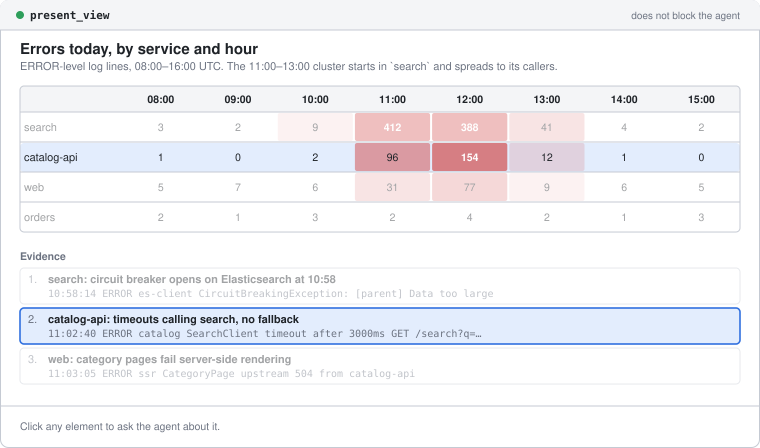

<details>
<summary>Chamada à ferramenta</summary>

```json
{
  "tool": "present_view",
  "arguments": {
    "title": "Errors today, by service and hour",
    "context": "ERROR-level log lines, 08:00–16:00 UTC. The 11:00–13:00 cluster starts in `search` and spreads to its callers.",
    "blocks": [
      {
        "type": "matrix",
        "columns": [
          {"id":"h08","label":"08:00"},
          {"id":"h09","label":"09:00"},
          {"id":"h10","label":"10:00"},
          {"id":"h11","label":"11:00"},
          {"id":"h12","label":"12:00"},
          {"id":"h13","label":"13:00"},
          {"id":"h14","label":"14:00"},
          {"id":"h15","label":"15:00"}
        ],
        "rows": [
          {
            "id": "search",
            "label": "search",
            "cells": [
              {"v":"3","heat":0},
              {"v":"2","heat":0},
              {"v":"9","heat":1},
              {"v":"412","heat":5},
              {"v":"388","heat":5},
              {"v":"41","heat":2},
              {"v":"4","heat":0},
              {"v":"2","heat":0}
            ]
          },
          {
            "id": "catalog",
            "label": "catalog-api",
            "cells": [
              {"v":"1","heat":0},
              {"v":"0","heat":0},
              {"v":"2","heat":0},
              {"v":"96","heat":3},
              {"v":"154","heat":4},
              {"v":"12","heat":1},
              {"v":"1","heat":0},
              {"v":"0","heat":0}
            ]
          },
          {
            "id": "web",
            "label": "web",
            "cells": [
              {"v":"5","heat":0},
              {"v":"7","heat":0},
              {"v":"6","heat":0},
              {"v":"31","heat":2},
              {"v":"77","heat":3},
              {"v":"9","heat":1},
              {"v":"6","heat":0},
              {"v":"5","heat":0}
            ]
          },
          {
            "id": "orders",
            "label": "orders",
            "cells": [
              {"v":"2","heat":0},
              {"v":"1","heat":0},
              {"v":"3","heat":0},
              {"v":"2","heat":0},
              {"v":"4","heat":0},
              {"v":"2","heat":0},
              {"v":"1","heat":0},
              {"v":"3","heat":0}
            ]
          }
        ]
      },
      {
        "type": "steps",
        "label": "Evidence",
        "items": [
          {
            "id": "search",
            "label": "search: circuit breaker opens on Elasticsearch at 10:58",
            "detail": "10:58:14 ERROR es-client CircuitBreakingException: [parent] Data too large"
          },
          {
            "id": "catalog",
            "label": "catalog-api: timeouts calling search, no fallback",
            "detail": "11:02:40 ERROR catalog SearchClient timeout after 3000ms GET /search?q=…"
          },
          {
            "id": "web",
            "label": "web: category pages fail server-side rendering",
            "detail": "11:03:05 ERROR ssr CategoryPage upstream 504 from catalog-api"
          }
        ],
        "mono": true
      }
    ]
  }
}
```

</details>

<a id="19-performance-before-after"></a>

### 19. Medições antes e depois

**Situação.** O agente implementou um cache e mediu o resultado. O ganho existe, mas custa memória e complexidade de invalidação.

**Por que visual.** Comparar números lado a lado em barras é mais rápido e mais honesto do que uma frase como "melhorou bastante".

**O que o agente mostra.** Latências medidas antes e depois, e uma tabela com o que a mudança custa.

**Interação.** Aprovar ou rejeitar a mudança como um todo.

| | |
|---|---|
| Ferramenta | `present_decision` |
| Componentes | `chart`, `matrix` |
| Mecanismos | resposta `approve` |
| Resposta | `approve` no todo |
| Fontes | benchmark local (k6), métricas (MCP do Grafana) |
| Ainda não implementado | nada |

**Mensagem de volta ao chat.**

```text
Approved "Caching the product listing".
```

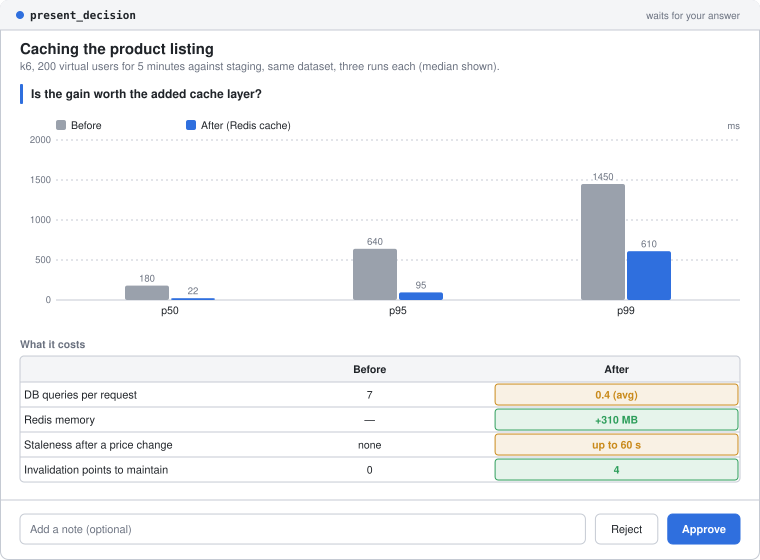

<details>
<summary>Chamada à ferramenta</summary>

```json
{
  "tool": "present_decision",
  "arguments": {
    "title": "Caching the product listing",
    "context": "k6, 200 virtual users for 5 minutes against staging, same dataset, three runs each (median shown).",
    "question": "Is the gain worth the added cache layer?",
    "blocks": [
      {
        "type": "chart",
        "kind": "bar",
        "unit": "ms",
        "categories": ["p50","p95","p99"],
        "series": [
          {"id":"before","label":"Before","values":[180,640,1450]},
          {"id":"after","label":"After (Redis cache)","values":[22,95,610]}
        ]
      },
      {
        "type": "matrix",
        "label": "What it costs",
        "columns": [{"id":"before","label":"Before"},{"id":"after","label":"After"}],
        "rows": [
          {"id":"c1","label":"DB queries per request","cells":["7",{"v":"0.4 (avg)","change":"changed"}]},
          {"id":"c2","label":"Redis memory","cells":["—",{"v":"+310 MB","change":"added"}]},
          {"id":"c3","label":"Staleness after a price change","cells":["none",{"v":"up to 60 s","change":"changed"}]},
          {"id":"c4","label":"Invalidation points to maintain","cells":["0",{"v":"4","change":"added"}]}
        ]
      }
    ],
    "response": {"type":"approve"}
  }
}
```

</details>

## Especificar

O agente encontra lacunas na especificação e as torna explícitas.

<a id="20-business-rules"></a>

### 20. Regras de negócio e permissões

**Situação.** O agente vai implementar permissões por papel. A especificação cobre a maioria dos casos, mas deixa combinações em aberto.

**Por que visual.** Uma tabela de decisão expõe as lacunas: cada célula vazia é uma pergunta que o texto da especificação escondia.

**O que o agente mostra.** A matriz papel × ação com o que a especificação define e as células em aberto, e a lista das combinações que precisam de resposta.

**Interação.** Marcar quais combinações em aberto devem ser permitidas; a célula e o item têm o mesmo id e se destacam juntos.

| | |
|---|---|
| Ferramenta | `present_decision` |
| Componentes | `matrix`, `steps` |
| Mecanismos | destaque ligado, resposta `choose_many` |
| Resposta | `choose_many` por item |
| Fontes | especificação / ticket, leitura do código |
| Ainda não implementado | nada |

**Mensagem de volta ao chat.**

```text
Selection for "Project permissions by role": q1, q3. Not selected: q2, q4.
```

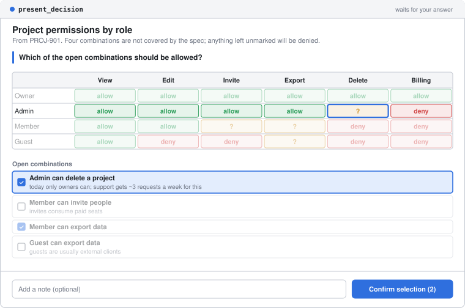

<details>
<summary>Chamada à ferramenta</summary>

```json
{
  "tool": "present_decision",
  "arguments": {
    "title": "Project permissions by role",
    "context": "From PROJ-901. Four combinations are not covered by the spec; anything left unmarked will be denied.",
    "question": "Which of the open combinations should be allowed?",
    "blocks": [
      {
        "type": "matrix",
        "columns": [
          {"id":"view","label":"View"},
          {"id":"edit","label":"Edit"},
          {"id":"invite","label":"Invite"},
          {"id":"export","label":"Export"},
          {"id":"delete","label":"Delete"},
          {"id":"billing","label":"Billing"}
        ],
        "rows": [
          {
            "id": "owner",
            "label": "Owner",
            "cells": [
              {"v":"allow","status":"ok"},
              {"v":"allow","status":"ok"},
              {"v":"allow","status":"ok"},
              {"v":"allow","status":"ok"},
              {"v":"allow","status":"ok"},
              {"v":"allow","status":"ok"}
            ]
          },
          {
            "id": "admin",
            "label": "Admin",
            "cells": [
              {"v":"allow","status":"ok"},
              {"v":"allow","status":"ok"},
              {"v":"allow","status":"ok"},
              {"v":"allow","status":"ok"},
              {"id":"q1","v":"?","status":"warn"},
              {"v":"deny","status":"failed"}
            ]
          },
          {
            "id": "member",
            "label": "Member",
            "cells": [
              {"v":"allow","status":"ok"},
              {"v":"allow","status":"ok"},
              {"id":"q2","v":"?","status":"warn"},
              {"id":"q3","v":"?","status":"warn"},
              {"v":"deny","status":"failed"},
              {"v":"deny","status":"failed"}
            ]
          },
          {
            "id": "guest",
            "label": "Guest",
            "cells": [
              {"v":"allow","status":"ok"},
              {"v":"deny","status":"failed"},
              {"v":"deny","status":"failed"},
              {"id":"q4","v":"?","status":"warn"},
              {"v":"deny","status":"failed"},
              {"v":"deny","status":"failed"}
            ]
          }
        ]
      },
      {
        "type": "steps",
        "id": "open",
        "label": "Open combinations",
        "numbered": false,
        "items": [
          {
            "id": "q1",
            "label": "Admin can delete a project",
            "detail": "today only owners can; support gets ~3 requests a week for this"
          },
          {"id":"q2","label":"Member can invite people","detail":"invites consume paid seats"},
          {"id":"q3","label":"Member can export data"},
          {"id":"q4","label":"Guest can export data","detail":"guests are usually external clients"}
        ]
      }
    ],
    "response": {"type":"choose_many","of":"open"}
  }
}
```

</details>

<a id="21-test-scenarios"></a>

### 21. Cenários de teste e cobertura

**Situação.** Antes de escrever testes para o fluxo de reembolso, o agente mapeia os comportamentos e o que já está coberto em cada nível.

**Por que visual.** Cobertura por comportamento (não por linha) é uma matriz; as lacunas ficam visíveis como células vazias.

**O que o agente mostra.** Comportamentos nas linhas, níveis de teste nas colunas, com o que existe e o que falta.

**Interação.** Marcar quais lacunas o agente deve cobrir agora.

| | |
|---|---|
| Ferramenta | `present_decision` |
| Componentes | `matrix` |
| Mecanismos | marcadores `status`, resposta `choose_many` |
| Resposta | `choose_many` por item |
| Fontes | leitura dos testes, relatório de cobertura |
| Ainda não implementado | nada |

**Mensagem de volta ao chat.**

```text
Selection for "Refund flow — test coverage": b3, b4, b6. Not selected: b1, b2, b5.
```

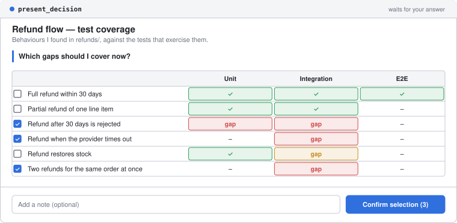

<details>
<summary>Chamada à ferramenta</summary>

```json
{
  "tool": "present_decision",
  "arguments": {
    "title": "Refund flow — test coverage",
    "context": "Behaviours I found in refunds/, against the tests that exercise them.",
    "question": "Which gaps should I cover now?",
    "blocks": [
      {
        "type": "matrix",
        "id": "behaviours",
        "columns": [{"id":"unit","label":"Unit"},{"id":"integration","label":"Integration"},{"id":"e2e","label":"E2E"}],
        "rows": [
          {
            "id": "b1",
            "label": "Full refund within 30 days",
            "cells": [{"v":"✓","status":"ok"},{"v":"✓","status":"ok"},{"v":"✓","status":"ok"}]
          },
          {
            "id": "b2",
            "label": "Partial refund of one line item",
            "cells": [{"v":"✓","status":"ok"},{"v":"✓","status":"ok"},{"v":"–"}]
          },
          {
            "id": "b3",
            "label": "Refund after 30 days is rejected",
            "cells": [{"v":"gap","status":"failed"},{"v":"gap","status":"failed"},{"v":"–"}]
          },
          {
            "id": "b4",
            "label": "Refund when the provider times out",
            "cells": [{"v":"–"},{"v":"gap","status":"failed"},{"v":"–"}]
          },
          {
            "id": "b5",
            "label": "Refund restores stock",
            "cells": [{"v":"✓","status":"ok"},{"v":"gap","status":"warn"},{"v":"–"}]
          },
          {
            "id": "b6",
            "label": "Two refunds for the same order at once",
            "cells": [{"v":"–"},{"v":"gap","status":"failed"},{"v":"–"}]
          }
        ]
      }
    ],
    "response": {"type":"choose_many","of":"behaviours"}
  }
}
```

</details>

## Git

Histórico, conflitos e transporte de commits entre branches.

<a id="22-branch-divergence"></a>

### 22. Divergência entre branches

**Situação.** Uma branch de release ficou para trás e alguém pergunta o que falta nela. O agente compara as branches.

**Por que visual.** O histórico do Git é um grafo; em texto (`git log --graph`) ele é difícil de ler, e o que interessa (o que falta, o que conflita) não fica destacado.

**O que o agente mostra.** O grafo de commits das branches envolvidas, com lentes para os commits que faltam na release e os que tocam os mesmos arquivos.

**Interação.** Alternar a lente; clicar num commit pergunta sobre ele.

| | |
|---|---|
| Ferramenta | `present_view` |
| Componentes | `graph` |
| Mecanismos | estados (lentes), perguntar sobre isto |
| Resposta | nenhuma |
| Fontes | `git log --graph`, `git cherry`, `git diff --stat` |
| Ainda não implementado | nada |

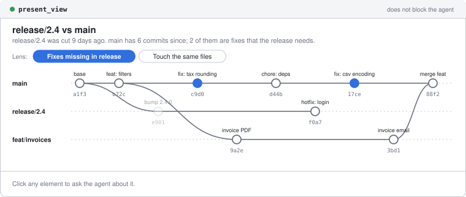

<details>
<summary>Chamada à ferramenta</summary>

```json
{
  "tool": "present_view",
  "arguments": {
    "title": "release/2.4 vs main",
    "context": "release/2.4 was cut 9 days ago. main has 6 commits since; 2 of them are fixes that the release needs.",
    "lenses": [{"id":"missing","label":"Fixes missing in release"},{"id":"overlap","label":"Touch the same files"}],
    "blocks": [
      {
        "type": "graph",
        "variant": "commits",
        "lanes": [{"id":"main","label":"main"},{"id":"rel","label":"release/2.4"},{"id":"feat","label":"feat/invoices"}],
        "nodes": [
          {"id":"c1","label":"a1f3","lane":"main","note":"base"},
          {"id":"c2","label":"b72c","lane":"main","note":"feat: filters"},
          {
            "id": "r1",
            "label": "e901",
            "lane": "rel",
            "note": "bump 2.4.0",
            "emphasis": "faded",
            "when": {"overlap":{"emphasis":"highlighted"}}
          },
          {
            "id": "c3",
            "label": "c9d0",
            "lane": "main",
            "note": "fix: tax rounding",
            "emphasis": "faded",
            "when": {"missing":{"emphasis":"highlighted"},"overlap":{"emphasis":"highlighted"}}
          },
          {"id":"f1","label":"9a2e","lane":"feat","note":"invoice PDF"},
          {"id":"c4","label":"d44b","lane":"main","note":"chore: deps"},
          {"id":"r2","label":"f0a7","lane":"rel","note":"hotfix: login"},
          {
            "id": "c5",
            "label": "17ce",
            "lane": "main",
            "note": "fix: csv encoding",
            "emphasis": "faded",
            "when": {"missing":{"emphasis":"highlighted"}}
          },
          {"id":"f2","label":"3bd1","lane":"feat","note":"invoice email"},
          {"id":"c6","label":"88f2","lane":"main","note":"merge feat"}
        ],
        "edges": [
          {"from":"c1","to":"c2"},
          {"from":"c2","to":"c3"},
          {"from":"c1","to":"r1"},
          {"from":"c3","to":"c4"},
          {"from":"c2","to":"f1"},
          {"from":"r1","to":"r2"},
          {"from":"c4","to":"c5"},
          {"from":"f1","to":"f2"},
          {"from":"c5","to":"c6"},
          {"from":"f2","to":"c6"}
        ]
      }
    ]
  }
}
```

</details>

<a id="23-merge-conflicts"></a>

### 23. Resolução de conflitos de merge

**Situação.** Um rebase parou em três conflitos. O agente entende a intenção de cada lado e propõe resoluções, mas a escolha é do usuário.

**Por que visual.** Marcadores de conflito mostram texto, não intenção. Um cartão por lado, com o que cada mudança queria fazer, deixa a escolha informada.

**O que o agente mostra.** Para cada conflito, cartões "nosso", "deles" e "ambos" com a intenção de cada lado e a recomendação do agente.

**Interação.** Escolher uma resolução por conflito e confirmar todas de uma vez.

| | |
|---|---|
| Ferramenta | `present_decision` |
| Componentes | `cards` |
| Mecanismos | resposta `choose_one` por item |
| Resposta | `choose_one` por bloco |
| Fontes | `git status`, `git diff` dos dois lados, mensagens de commit |
| Ainda não implementado | nada |

**Mensagem de volta ao chat.**

```text
Resolutions for "Rebase of feat/invoices onto main": conflict-1 → both, conflict-2 → theirs, conflict-3 → ours.
```

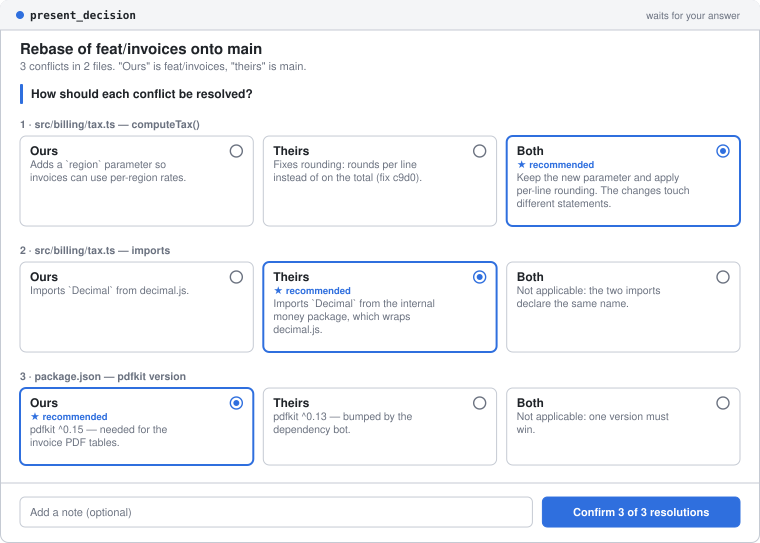

<details>
<summary>Chamada à ferramenta</summary>

```json
{
  "tool": "present_decision",
  "arguments": {
    "title": "Rebase of feat/invoices onto main",
    "context": "3 conflicts in 2 files. \"Ours\" is feat/invoices, \"theirs\" is main.",
    "question": "How should each conflict be resolved?",
    "blocks": [
      {
        "type": "cards",
        "id": "conflict-1",
        "label": "1 · src/billing/tax.ts — computeTax()",
        "items": [
          {"id":"ours","title":"Ours","summary":"Adds a `region` parameter so invoices can use per-region rates."},
          {
            "id": "theirs",
            "title": "Theirs",
            "summary": "Fixes rounding: rounds per line instead of on the total (fix c9d0)."
          },
          {
            "id": "both",
            "title": "Both",
            "summary": "Keep the new parameter and apply per-line rounding. The changes touch different statements.",
            "recommended": true
          }
        ]
      },
      {
        "type": "cards",
        "id": "conflict-2",
        "label": "2 · src/billing/tax.ts — imports",
        "items": [
          {"id":"ours","title":"Ours","summary":"Imports `Decimal` from decimal.js."},
          {
            "id": "theirs",
            "title": "Theirs",
            "summary": "Imports `Decimal` from the internal money package, which wraps decimal.js.",
            "recommended": true
          },
          {"id":"both","title":"Both","summary":"Not applicable: the two imports declare the same name."}
        ]
      },
      {
        "type": "cards",
        "id": "conflict-3",
        "label": "3 · package.json — pdfkit version",
        "items": [
          {
            "id": "ours",
            "title": "Ours",
            "summary": "pdfkit ^0.15 — needed for the invoice PDF tables.",
            "recommended": true
          },
          {"id":"theirs","title":"Theirs","summary":"pdfkit ^0.13 — bumped by the dependency bot."},
          {"id":"both","title":"Both","summary":"Not applicable: one version must win."}
        ]
      }
    ],
    "response": {"type":"choose_one","of":["conflict-1","conflict-2","conflict-3"]}
  }
}
```

</details>

<a id="24-cherry-pick-plan"></a>

### 24. Plano de cherry-pick ou rebase

**Situação.** É preciso levar correções da main para a branch de release. Alguns commits dependem de outros que não deveriam ir.

**Por que visual.** A ordem importa e as dependências entre commits não aparecem numa lista de hashes. Uma lista de passos com alertas deixa o plano revisável.

**O que o agente mostra.** Os commits na ordem em que seriam aplicados, com o que cada um faz e os alertas de dependência ou conflito.

**Interação.** Aprovar ou rejeitar cada commit.

| | |
|---|---|
| Ferramenta | `present_decision` |
| Componentes | `steps` |
| Mecanismos | marcadores `status`, resposta `approve` por item |
| Resposta | `approve` por item |
| Fontes | `git log main ^release/2.4`, `git cherry-pick --no-commit` (ensaio) |
| Ainda não implementado | nada |

**Mensagem de volta ao chat.**

```text
Review of "Backport to release/2.4": approved k1, k2, k4; rejected k3.
Note: pick 4e1a and resolve the conflict by hand, without the filters feature
```

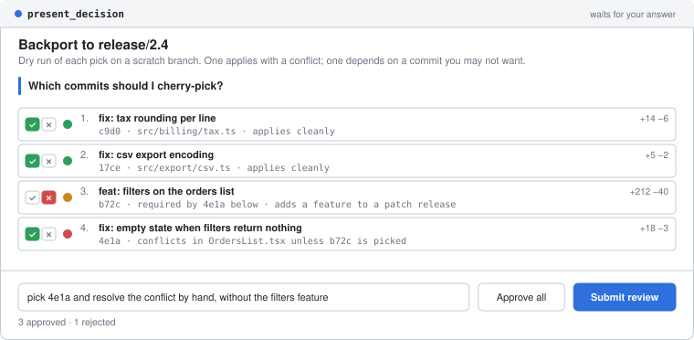

<details>
<summary>Chamada à ferramenta</summary>

```json
{
  "tool": "present_decision",
  "arguments": {
    "title": "Backport to release/2.4",
    "context": "Dry run of each pick on a scratch branch. One applies with a conflict; one depends on a commit you may not want.",
    "question": "Which commits should I cherry-pick?",
    "blocks": [
      {
        "type": "steps",
        "id": "picks",
        "items": [
          {
            "id": "k1",
            "label": "fix: tax rounding per line",
            "detail": "c9d0 · src/billing/tax.ts · applies cleanly",
            "status": "ok",
            "meta": "+14 −6"
          },
          {
            "id": "k2",
            "label": "fix: csv export encoding",
            "detail": "17ce · src/export/csv.ts · applies cleanly",
            "status": "ok",
            "meta": "+5 −2"
          },
          {
            "id": "k3",
            "label": "feat: filters on the orders list",
            "detail": "b72c · required by 4e1a below · adds a feature to a patch release",
            "status": "warn",
            "meta": "+212 −40"
          },
          {
            "id": "k4",
            "label": "fix: empty state when filters return nothing",
            "detail": "4e1a · conflicts in OrdersList.tsx unless b72c is picked",
            "status": "failed",
            "meta": "+18 −3"
          }
        ],
        "mono": true
      }
    ],
    "response": {"type":"approve","of":"picks"}
  }
}
```

</details>

## CI/CD

Estado de pipelines e ambientes, como retrato montado pelo agente.

<a id="25-pipeline-run"></a>

### 25. Execução de uma pipeline

**Situação.** A pipeline falhou e o usuário pergunta o que houve. O agente lê a execução e os logs do job que quebrou.

**Por que visual.** A pipeline já é um grafo; mostrar onde parou, o que nem chegou a rodar e a causa no próprio nó evita abrir a ferramenta de CI.

**O que o agente mostra.** Os jobs como grafo com o status de cada um e a causa da falha em destaque.

**Interação.** Clicar num job pergunta sobre ele (por exemplo, pedir o trecho do log).

| | |
|---|---|
| Ferramenta | `present_view` |
| Componentes | `graph` |
| Mecanismos | marcadores `status`, passo a passo, perguntar sobre isto |
| Resposta | nenhuma |
| Fontes | MCP do GitHub Actions / GitLab CI, logs do job |
| Ainda não implementado | nada |

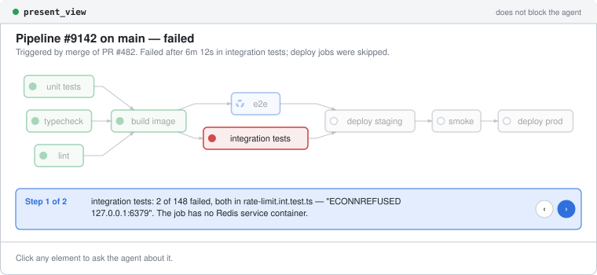

<details>
<summary>Chamada à ferramenta</summary>

```json
{
  "tool": "present_view",
  "arguments": {
    "title": "Pipeline #9142 on main — failed",
    "context": "Triggered by merge of PR #482. Failed after 6m 12s in integration tests; deploy jobs were skipped.",
    "blocks": [
      {
        "type": "graph",
        "direction": "LR",
        "nodes": [
          {"id":"lint","label":"lint","status":"ok"},
          {"id":"types","label":"typecheck","status":"ok"},
          {"id":"unit","label":"unit tests","status":"ok"},
          {"id":"build","label":"build image","status":"ok"},
          {"id":"integ","label":"integration tests","status":"failed"},
          {"id":"e2e","label":"e2e","status":"running"},
          {"id":"stg","label":"deploy staging","status":"pending"},
          {"id":"smoke","label":"smoke","status":"pending"},
          {"id":"prod","label":"deploy prod","status":"pending"}
        ],
        "edges": [
          {"from":"lint","to":"build"},
          {"from":"types","to":"build"},
          {"from":"unit","to":"build"},
          {"from":"build","to":"integ"},
          {"from":"build","to":"e2e"},
          {"from":"integ","to":"stg"},
          {"from":"e2e","to":"stg"},
          {"from":"stg","to":"smoke"},
          {"from":"smoke","to":"prod"}
        ]
      }
    ],
    "walkthrough": [
      {
        "text": "integration tests: 2 of 148 failed, both in rate-limit.int.test.ts — \"ECONNREFUSED 127.0.0.1:6379\". The job has no Redis service container.",
        "focus": ["integ"]
      },
      {
        "text": "The new middleware needs Redis, and ci.yml only starts Postgres for this job. Adding a redis service to the job should fix it.",
        "focus": ["integ","build"]
      }
    ]
  }
}
```

</details>

<a id="26-versions-per-environment"></a>

### 26. Versões por ambiente

**Situação.** Antes de promover para produção, o usuário quer saber o que está rodando em cada ambiente e o que está defasado.

**Por que visual.** Serviço × ambiente é uma matriz; a defasagem aparece como células marcadas em vez de exigir comparar listas.

**O que o agente mostra.** Uma matriz de serviços por ambiente com a versão em cada um, marcando onde produção está atrás e onde um deploy falhou.

**Interação.** Clicar numa célula pergunta o que mudou entre as versões.

| | |
|---|---|
| Ferramenta | `present_view` |
| Componentes | `matrix` |
| Mecanismos | marcadores `status` e `change`, perguntar sobre isto |
| Resposta | nenhuma |
| Fontes | MCP do Kubernetes / Argo CD, registro de imagens |
| Ainda não implementado | nada |

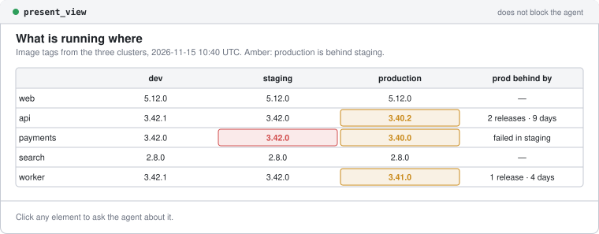

<details>
<summary>Chamada à ferramenta</summary>

```json
{
  "tool": "present_view",
  "arguments": {
    "title": "What is running where",
    "context": "Image tags from the three clusters, 2026-11-15 10:40 UTC. Amber: production is behind staging.",
    "blocks": [
      {
        "type": "matrix",
        "columns": [
          {"id":"dev","label":"dev"},
          {"id":"staging","label":"staging"},
          {"id":"prod","label":"production"},
          {"id":"behind","label":"prod behind by"}
        ],
        "rows": [
          {"id":"web","label":"web","cells":["5.12.0","5.12.0","5.12.0","—"]},
          {
            "id": "api",
            "label": "api",
            "cells": ["3.42.1","3.42.0",{"v":"3.40.2","change":"changed"},"2 releases · 9 days"]
          },
          {
            "id": "payments",
            "label": "payments",
            "cells": ["3.42.0",{"v":"3.42.0","status":"failed"},{"v":"3.40.0","change":"changed"},"failed in staging"]
          },
          {"id":"search","label":"search","cells":["2.8.0","2.8.0","2.8.0","—"]},
          {
            "id": "worker",
            "label": "worker",
            "cells": ["3.42.1","3.42.0",{"v":"3.41.0","change":"changed"},"1 release · 4 days"]
          }
        ]
      }
    ]
  }
}
```

</details>

<a id="27-flaky-tests"></a>

### 27. Testes instáveis

**Situação.** A pipeline falha de vez em quando sem mudança de código. O agente analisa as últimas execuções para separar teste instável de bug real.

**Por que visual.** Instabilidade é um padrão ao longo de execuções; uma grade teste × execução mostra de imediato quem falha sempre e quem falha às vezes.

**O que o agente mostra.** Os testes que falharam ao menos uma vez nas últimas dez execuções, com o resultado em cada uma e o diagnóstico do agente.

**Interação.** Marcar quais testes colocar em quarentena.

| | |
|---|---|
| Ferramenta | `present_decision` |
| Componentes | `matrix` |
| Mecanismos | marcadores `status`, resposta `choose_many` |
| Resposta | `choose_many` por item |
| Fontes | MCP do CI, relatórios JUnit |
| Ainda não implementado | nada |

**Mensagem de volta ao chat.**

```text
Selection for "Flaky tests on main, last 10 runs": ft1, ft3. Not selected: ft2, ft4.
```

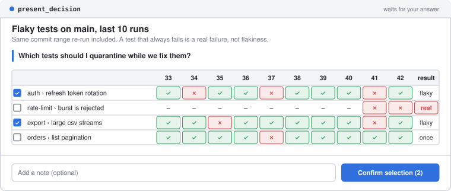

<details>
<summary>Chamada à ferramenta</summary>

```json
{
  "tool": "present_decision",
  "arguments": {
    "title": "Flaky tests on main, last 10 runs",
    "context": "Same commit range re-run included. A test that always fails is a real failure, not flakiness.",
    "question": "Which tests should I quarantine while we fix them?",
    "blocks": [
      {
        "type": "matrix",
        "id": "tests",
        "columns": [
          {"id":"#9133","label":"33"},
          {"id":"#9134","label":"34"},
          {"id":"#9135","label":"35"},
          {"id":"#9136","label":"36"},
          {"id":"#9137","label":"37"},
          {"id":"#9138","label":"38"},
          {"id":"#9139","label":"39"},
          {"id":"#9140","label":"40"},
          {"id":"#9141","label":"41"},
          {"id":"#9142","label":"42"},
          {"id":"verdict","label":"result"}
        ],
        "rows": [
          {
            "id": "ft1",
            "label": "auth › refresh token rotation",
            "cells": [
              {"v":"✓","status":"ok"},
              {"v":"✗","status":"failed"},
              {"v":"✓","status":"ok"},
              {"v":"✓","status":"ok"},
              {"v":"✗","status":"failed"},
              {"v":"✓","status":"ok"},
              {"v":"✓","status":"ok"},
              {"v":"✓","status":"ok"},
              {"v":"✗","status":"failed"},
              {"v":"✓","status":"ok"},
              "flaky"
            ]
          },
          {
            "id": "ft2",
            "label": "rate-limit › burst is rejected",
            "cells": [
              {"v":"–"},
              {"v":"–"},
              {"v":"–"},
              {"v":"–"},
              {"v":"–"},
              {"v":"–"},
              {"v":"–"},
              {"v":"–"},
              {"v":"✗","status":"failed"},
              {"v":"✗","status":"failed"},
              {"v":"real","status":"failed"}
            ]
          },
          {
            "id": "ft3",
            "label": "export › large csv streams",
            "cells": [
              {"v":"✓","status":"ok"},
              {"v":"✓","status":"ok"},
              {"v":"✗","status":"failed"},
              {"v":"✓","status":"ok"},
              {"v":"✓","status":"ok"},
              {"v":"✓","status":"ok"},
              {"v":"✓","status":"ok"},
              {"v":"✓","status":"ok"},
              {"v":"✗","status":"failed"},
              {"v":"✓","status":"ok"},
              "flaky"
            ]
          },
          {
            "id": "ft4",
            "label": "orders › list pagination",
            "cells": [
              {"v":"✓","status":"ok"},
              {"v":"✓","status":"ok"},
              {"v":"✓","status":"ok"},
              {"v":"✓","status":"ok"},
              {"v":"✗","status":"failed"},
              {"v":"✓","status":"ok"},
              {"v":"✓","status":"ok"},
              {"v":"✓","status":"ok"},
              {"v":"✓","status":"ok"},
              {"v":"✓","status":"ok"},
              "once"
            ]
          }
        ]
      }
    ],
    "response": {"type":"choose_many","of":"tests"}
  }
}
```

</details>

## Ágil

Tickets, sprints e o cruzamento entre o quadro e o que de fato foi entregue.

<a id="28-epic-breakdown"></a>

### 28. Quebra de épico em histórias e tarefas

**Situação.** O usuário pede ao agente que quebre um épico em histórias e crie os tickets. Antes de criar qualquer coisa, o agente mostra a proposta.

**Por que visual.** A quebra é hierárquica e o usuário quer vetar partes antes que virem tickets. Uma árvore com aprovação por história evita limpar o Jira depois.

**O que o agente mostra.** A árvore épico → histórias → tarefas, com a estimativa de cada história.

**Interação.** Aprovar ou rejeitar cada história; só as aprovadas são criadas.

| | |
|---|---|
| Ferramenta | `present_decision` |
| Componentes | `tree` |
| Mecanismos | resposta `approve` por item |
| Resposta | `approve` por item |
| Fontes | descrição do épico, MCP do Jira / Linear |
| Ainda não implementado | nada |

**Mensagem de volta ao chat.**

```text
Review of "Epic: Organisations": approved us1, us2, us3; rejected us4.
Note: SSO goes to a separate epic
```

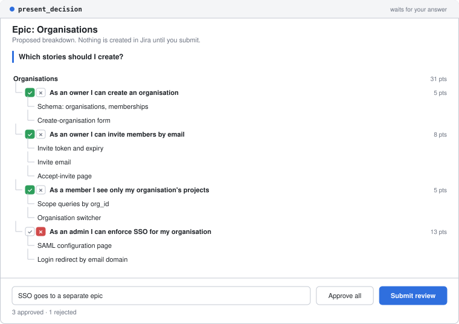

<details>
<summary>Chamada à ferramenta</summary>

```json
{
  "tool": "present_decision",
  "arguments": {
    "title": "Epic: Organisations",
    "context": "Proposed breakdown. Nothing is created in Jira until you submit.",
    "question": "Which stories should I create?",
    "blocks": [
      {
        "type": "tree",
        "id": "stories",
        "nodes": [
          {"id":"epic","label":"Organisations","meta":"31 pts"},
          {"id":"us1","label":"As an owner I can create an organisation","meta":"5 pts","parent":"epic"},
          {"id":"us1a","label":"Schema: organisations, memberships","parent":"us1"},
          {"id":"us1b","label":"Create-organisation form","parent":"us1"},
          {"id":"us2","label":"As an owner I can invite members by email","meta":"8 pts","parent":"epic"},
          {"id":"us2a","label":"Invite token and expiry","parent":"us2"},
          {"id":"us2b","label":"Invite email","parent":"us2"},
          {"id":"us2c","label":"Accept-invite page","parent":"us2"},
          {"id":"us3","label":"As a member I see only my organisation's projects","meta":"5 pts","parent":"epic"},
          {"id":"us3a","label":"Scope queries by org_id","parent":"us3"},
          {"id":"us3b","label":"Organisation switcher","parent":"us3"},
          {"id":"us4","label":"As an admin I can enforce SSO for my organisation","meta":"13 pts","parent":"epic"},
          {"id":"us4a","label":"SAML configuration page","parent":"us4"},
          {"id":"us4b","label":"Login redirect by email domain","parent":"us4"}
        ]
      }
    ],
    "response": {"type":"approve","of":"stories","depth":1}
  }
}
```

</details>

<a id="29-ticket-dependencies"></a>

### 29. Dependências entre tickets

**Situação.** No planejamento, o usuário pergunta o que bloqueia a entrega. Os links de "bloqueia" estão no Jira, mas ninguém os vê juntos.

**Por que visual.** Dependências formam um grafo e o caminho crítico é uma propriedade do grafo, impossível de ver numa lista de tickets.

**O que o agente mostra.** Os tickets como grafo de dependências com o status de cada um e uma lente para o caminho crítico.

**Interação.** Alternar a lente do caminho crítico; clicar num ticket pergunta sobre ele.

| | |
|---|---|
| Ferramenta | `present_view` |
| Componentes | `graph` |
| Mecanismos | estados (lentes), marcadores `status`, perguntar sobre isto |
| Resposta | nenhuma |
| Fontes | MCP do Jira / Linear |
| Ainda não implementado | nada |

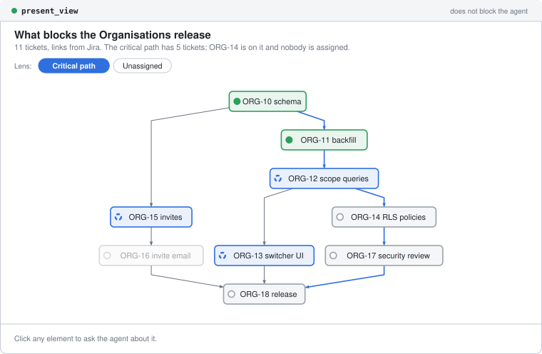

<details>
<summary>Chamada à ferramenta</summary>

```json
{
  "tool": "present_view",
  "arguments": {
    "title": "What blocks the Organisations release",
    "context": "11 tickets, links from Jira. The critical path has 5 tickets; ORG-14 is on it and nobody is assigned.",
    "lenses": [{"id":"critical","label":"Critical path"},{"id":"unassigned","label":"Unassigned"}],
    "blocks": [
      {
        "type": "graph",
        "direction": "LR",
        "nodes": [
          {
            "id": "o10",
            "label": "ORG-10 schema",
            "status": "ok",
            "emphasis": "faded",
            "when": {"critical":{"emphasis":"highlighted"}}
          },
          {
            "id": "o11",
            "label": "ORG-11 backfill",
            "status": "ok",
            "emphasis": "faded",
            "when": {"critical":{"emphasis":"highlighted"}}
          },
          {
            "id": "o12",
            "label": "ORG-12 scope queries",
            "status": "running",
            "emphasis": "faded",
            "when": {"critical":{"emphasis":"highlighted"}}
          },
          {"id":"o13","label":"ORG-13 switcher UI","status":"running"},
          {
            "id": "o14",
            "label": "ORG-14 RLS policies",
            "status": "pending",
            "emphasis": "faded",
            "when": {"critical":{"emphasis":"highlighted"},"unassigned":{"emphasis":"highlighted"}}
          },
          {"id":"o15","label":"ORG-15 invites","status":"running"},
          {
            "id": "o16",
            "label": "ORG-16 invite email",
            "status": "pending",
            "emphasis": "faded",
            "when": {"unassigned":{"emphasis":"highlighted"}}
          },
          {
            "id": "o17",
            "label": "ORG-17 security review",
            "status": "pending",
            "emphasis": "faded",
            "when": {"critical":{"emphasis":"highlighted"}}
          },
          {
            "id": "o18",
            "label": "ORG-18 release",
            "status": "pending",
            "emphasis": "faded",
            "when": {"critical":{"emphasis":"highlighted"}}
          }
        ],
        "edges": [
          {"from":"o10","to":"o11","emphasis":"faded","when":{"critical":{"emphasis":"highlighted"}}},
          {"from":"o11","to":"o12","emphasis":"faded","when":{"critical":{"emphasis":"highlighted"}}},
          {"from":"o12","to":"o14","emphasis":"faded","when":{"critical":{"emphasis":"highlighted"}}},
          {"from":"o12","to":"o13"},
          {"from":"o10","to":"o15"},
          {"from":"o15","to":"o16"},
          {"from":"o14","to":"o17","emphasis":"faded","when":{"critical":{"emphasis":"highlighted"}}},
          {"from":"o17","to":"o18","emphasis":"faded","when":{"critical":{"emphasis":"highlighted"}}},
          {"from":"o13","to":"o18"},
          {"from":"o16","to":"o18"}
        ]
      }
    ]
  }
}
```

</details>

<a id="30-sprint-board"></a>

### 30. Quadro da sprint

**Situação.** Na daily, o usuário pede um resumo da sprint. O agente lê o quadro e destaca o que merece atenção.

**Por que visual.** O quadro em colunas é a forma que o time já conhece. O valor do agente está no destaque: o que está parado, o que estourou o limite.

**O que o agente mostra.** As colunas do quadro com os cartões, destacando os itens parados e a coluna acima do limite de WIP.

**Interação.** Alternar a lente de itens parados; clicar num cartão pergunta sobre ele.

| | |
|---|---|
| Ferramenta | `present_view` |
| Componentes | `board` |
| Mecanismos | estados (lentes), marcadores `status`, perguntar sobre isto |
| Resposta | nenhuma |
| Fontes | MCP do Jira / Linear |
| Ainda não implementado | nada |

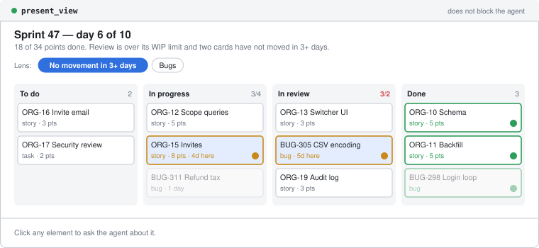

<details>
<summary>Chamada à ferramenta</summary>

```json
{
  "tool": "present_view",
  "arguments": {
    "title": "Sprint 47 — day 6 of 10",
    "context": "18 of 34 points done. Review is over its WIP limit and two cards have not moved in 3+ days.",
    "lenses": [{"id":"stale","label":"No movement in 3+ days"},{"id":"bugs","label":"Bugs"}],
    "blocks": [
      {
        "type": "board",
        "columns": [
          {
            "id": "todo",
            "label": "To do",
            "items": [
              {"id":"ORG-16","label":"ORG-16 Invite email","tag":"story · 3 pts"},
              {"id":"ORG-17","label":"ORG-17 Security review","tag":"task · 2 pts"}
            ]
          },
          {
            "id": "doing",
            "label": "In progress",
            "limit": 4,
            "items": [
              {"id":"ORG-12","label":"ORG-12 Scope queries","tag":"story · 5 pts"},
              {
                "id": "ORG-15",
                "label": "ORG-15 Invites",
                "tag": "story · 8 pts · 4d here",
                "status": "warn",
                "emphasis": "faded",
                "when": {"stale":{"emphasis":"highlighted"}}
              },
              {
                "id": "BUG-311",
                "label": "BUG-311 Refund tax",
                "tag": "bug · 1 day",
                "emphasis": "faded",
                "when": {"bugs":{"emphasis":"highlighted"}}
              }
            ]
          },
          {
            "id": "review",
            "label": "In review",
            "limit": 2,
            "items": [
              {"id":"ORG-13","label":"ORG-13 Switcher UI","tag":"story · 3 pts"},
              {
                "id": "BUG-305",
                "label": "BUG-305 CSV encoding",
                "tag": "bug · 5d here",
                "status": "warn",
                "emphasis": "faded",
                "when": {"stale":{"emphasis":"highlighted"},"bugs":{"emphasis":"highlighted"}}
              },
              {"id":"ORG-19","label":"ORG-19 Audit log","tag":"story · 3 pts"}
            ]
          },
          {
            "id": "done",
            "label": "Done",
            "items": [
              {"id":"ORG-10","label":"ORG-10 Schema","tag":"story · 5 pts","status":"ok"},
              {"id":"ORG-11","label":"ORG-11 Backfill","tag":"story · 5 pts","status":"ok"},
              {
                "id": "BUG-298",
                "label": "BUG-298 Login loop",
                "tag": "bug",
                "status": "ok",
                "emphasis": "faded",
                "when": {"bugs":{"emphasis":"highlighted"}}
              }
            ]
          }
        ]
      }
    ]
  }
}
```

</details>

<a id="31-traceability"></a>

### 31. Rastreabilidade história × PR × teste × deploy

**Situação.** Antes da review da sprint, o usuário quer saber o que de fato chegou em produção e o que está "pronto" só no quadro.

**Por que visual.** A informação está espalhada em três ferramentas. Cruzada numa matriz, a pergunta "isso está entregue?" vira uma linha.

**O que o agente mostra.** Uma linha por história com o estado do ticket, do PR, dos testes e do deploy.

**Interação.** Clicar numa célula pergunta sobre aquela pendência.

| | |
|---|---|
| Ferramenta | `present_view` |
| Componentes | `matrix` |
| Mecanismos | marcadores `status`, perguntar sobre isto |
| Resposta | nenhuma |
| Fontes | MCP do Jira / Linear, MCP do GitHub, MCP do CI/CD |
| Ainda não implementado | nada |

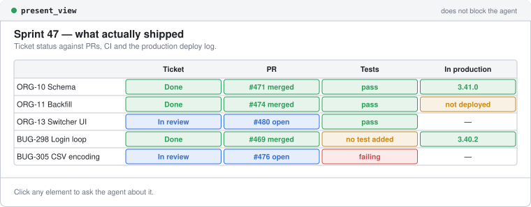

<details>
<summary>Chamada à ferramenta</summary>

```json
{
  "tool": "present_view",
  "arguments": {
    "title": "Sprint 47 — what actually shipped",
    "context": "Ticket status against PRs, CI and the production deploy log.",
    "blocks": [
      {
        "type": "matrix",
        "columns": [
          {"id":"ticket","label":"Ticket"},
          {"id":"pr","label":"PR"},
          {"id":"tests","label":"Tests"},
          {"id":"prod","label":"In production"}
        ],
        "rows": [
          {
            "id": "ORG-10",
            "label": "ORG-10 Schema",
            "cells": [
              {"v":"Done","status":"ok"},
              {"v":"#471 merged","status":"ok"},
              {"v":"pass","status":"ok"},
              {"v":"3.41.0","status":"ok"}
            ]
          },
          {
            "id": "ORG-11",
            "label": "ORG-11 Backfill",
            "cells": [
              {"v":"Done","status":"ok"},
              {"v":"#474 merged","status":"ok"},
              {"v":"pass","status":"ok"},
              {"v":"not deployed","status":"warn"}
            ]
          },
          {
            "id": "ORG-13",
            "label": "ORG-13 Switcher UI",
            "cells": [
              {"v":"In review","status":"running"},
              {"v":"#480 open","status":"running"},
              {"v":"pass","status":"ok"},
              {"v":"—"}
            ]
          },
          {
            "id": "BUG-298",
            "label": "BUG-298 Login loop",
            "cells": [
              {"v":"Done","status":"ok"},
              {"v":"#469 merged","status":"ok"},
              {"v":"no test added","status":"warn"},
              {"v":"3.40.2","status":"ok"}
            ]
          },
          {
            "id": "BUG-305",
            "label": "BUG-305 CSV encoding",
            "cells": [
              {"v":"In review","status":"running"},
              {"v":"#476 open","status":"running"},
              {"v":"failing","status":"failed"},
              {"v":"—"}
            ]
          }
        ]
      }
    ]
  }
}
```

</details>

## Além

Usos fora do ciclo pergunta-resposta: transparência do agente, explicação e auditoria.

<a id="32-agent-progress"></a>

### 32. Progresso do próprio agente

**Situação.** Numa tarefa longa com subagentes, o usuário volta depois de vinte minutos e quer saber em que ponto as coisas estão.

**Por que visual.** O texto do chat é uma sequência de eventos; o usuário quer o estado. Uma lista de passos com status é esse estado.

**O que o agente mostra.** O plano com o status de cada passo e uma tabela do que cada subagente está fazendo.

**Interação.** Clicar num passo pergunta sobre ele; a view pode ser reemitida a cada marco.

| | |
|---|---|
| Ferramenta | `present_view` |
| Componentes | `steps`, `matrix` |
| Mecanismos | marcadores `status`, perguntar sobre isto |
| Resposta | nenhuma |
| Fontes | estado interno do agente |
| Ainda não implementado | atualizar (novo retrato a pedido) |

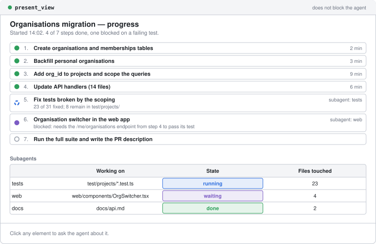

<details>
<summary>Chamada à ferramenta</summary>

```json
{
  "tool": "present_view",
  "arguments": {
    "title": "Organisations migration — progress",
    "context": "Started 14:02. 4 of 7 steps done, one blocked on a failing test.",
    "blocks": [
      {
        "type": "steps",
        "items": [
          {"id":"st1","label":"Create organisations and memberships tables","status":"ok","meta":"2 min"},
          {"id":"st2","label":"Backfill personal organisations","status":"ok","meta":"3 min"},
          {"id":"st3","label":"Add org_id to projects and scope the queries","status":"ok","meta":"9 min"},
          {"id":"st4","label":"Update API handlers (14 files)","status":"ok","meta":"6 min"},
          {
            "id": "st5",
            "label": "Fix tests broken by the scoping",
            "detail": "23 of 31 fixed; 8 remain in test/projects/",
            "status": "running",
            "meta": "subagent: tests"
          },
          {
            "id": "st6",
            "label": "Organisation switcher in the web app",
            "detail": "blocked: needs the /me/organisations endpoint from step 4 to pass its test",
            "status": "blocked",
            "meta": "subagent: web"
          },
          {"id":"st7","label":"Run the full suite and write the PR description","status":"pending"}
        ]
      },
      {
        "type": "matrix",
        "label": "Subagents",
        "columns": [{"id":"task","label":"Working on"},{"id":"state","label":"State"},{"id":"files","label":"Files touched"}],
        "rows": [
          {"id":"sa1","label":"tests","cells":["test/projects/*.test.ts",{"v":"running","status":"running"},"23"]},
          {"id":"sa2","label":"web","cells":["web/components/OrgSwitcher.tsx",{"v":"waiting","status":"blocked"},"4"]},
          {"id":"sa3","label":"docs","cells":["docs/api.md",{"v":"done","status":"ok"},"2"]}
        ]
      }
    ]
  }
}
```

</details>

<a id="33-codebase-tour"></a>

### 33. Tour de codebase

**Situação.** Alguém novo no projeto pede "me explica como esse repositório é organizado".

**Por que visual.** Uma arquitetura se entende seguindo um caminho por ela. O passo a passo sobre o grafo dá a ordem que um diagrama estático não tem.

**O que o agente mostra.** As camadas e módulos como grafo, percorridos por uma narrativa que segue uma requisição de ponta a ponta.

**Interação.** Avançar e voltar os passos; clicar num módulo pergunta sobre ele.

| | |
|---|---|
| Ferramenta | `present_view` |
| Componentes | `graph` |
| Mecanismos | passo a passo, perguntar sobre isto |
| Resposta | nenhuma |
| Fontes | leitura do código, README e docs |
| Ainda não implementado | detalhe sob demanda (arquivo:linha por elemento) |

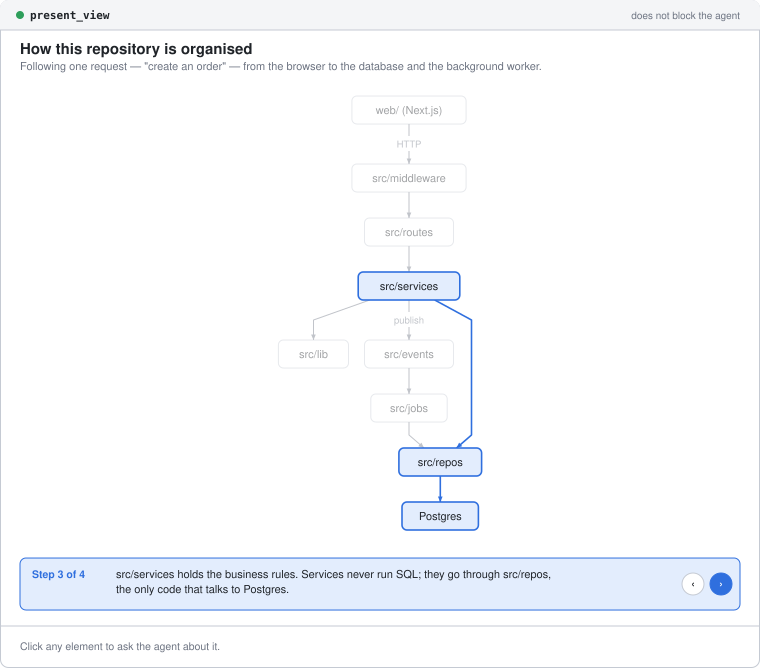

<details>
<summary>Chamada à ferramenta</summary>

```json
{
  "tool": "present_view",
  "arguments": {
    "title": "How this repository is organised",
    "context": "Following one request — \"create an order\" — from the browser to the database and the background worker.",
    "blocks": [
      {
        "type": "graph",
        "direction": "LR",
        "nodes": [
          {"id":"web","label":"web/ (Next.js)"},
          {"id":"routes","label":"src/routes"},
          {"id":"mw","label":"src/middleware"},
          {"id":"services","label":"src/services"},
          {"id":"repos","label":"src/repos"},
          {"id":"db","label":"Postgres"},
          {"id":"events","label":"src/events"},
          {"id":"jobs","label":"src/jobs"},
          {"id":"lib","label":"src/lib"}
        ],
        "edges": [
          {"from":"web","to":"mw","label":"HTTP"},
          {"from":"mw","to":"routes"},
          {"from":"routes","to":"services"},
          {"from":"services","to":"repos"},
          {"from":"repos","to":"db"},
          {"from":"services","to":"events","label":"publish"},
          {"from":"events","to":"jobs"},
          {"from":"jobs","to":"repos"},
          {"from":"services","to":"lib"}
        ]
      }
    ],
    "walkthrough": [
      {
        "text": "The browser calls the API. Every request passes through src/middleware first: auth, rate limiting, request id.",
        "focus": ["web","mw"]
      },
      {
        "text": "src/routes only parses and validates input, then calls a service. No business logic lives here.",
        "focus": ["mw","routes","services"]
      },
      {
        "text": "src/services holds the business rules. Services never run SQL; they go through src/repos, the only code that talks to Postgres.",
        "focus": ["services","repos","db"]
      },
      {
        "text": "Anything slow is published as an event and picked up by src/jobs: emails, exports, webhooks.",
        "focus": ["services","events","jobs"]
      }
    ]
  }
}
```

</details>

<a id="34-dependency-audit"></a>

### 34. Auditoria de dependências e segurança

**Situação.** O scanner de segurança apontou vulnerabilidades. Quase todas estão em dependências transitivas, e o usuário precisa saber o que atualizar.

**Por que visual.** A pergunta "de onde vem esse pacote?" é uma pergunta de árvore. Ver o caminho até a dependência direta mostra qual atualização resolve.

**O que o agente mostra.** A árvore de dependências reduzida aos caminhos que levam a pacotes vulneráveis, com a severidade e a versão que corrige.

**Interação.** Marcar quais dependências diretas atualizar.

| | |
|---|---|
| Ferramenta | `present_decision` |
| Componentes | `tree` |
| Mecanismos | marcadores `status` e `change`, resposta `choose_many` |
| Resposta | `choose_many` por item |
| Fontes | `npm audit --json`, `npm ls`, changelogs |
| Ainda não implementado | nada |

**Mensagem de volta ao chat.**

```text
Selection for "Vulnerable dependencies": dep1, dep3. Not selected: dep2.
Note: pdfkit goes with the invoices branch, which already needs 0.15
```

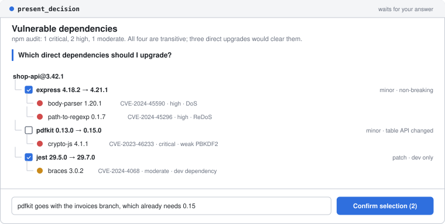

<details>
<summary>Chamada à ferramenta</summary>

```json
{
  "tool": "present_decision",
  "arguments": {
    "title": "Vulnerable dependencies",
    "context": "npm audit: 1 critical, 2 high, 1 moderate. All four are transitive; three direct upgrades would clear them.",
    "question": "Which direct dependencies should I upgrade?",
    "blocks": [
      {
        "type": "tree",
        "id": "deps",
        "nodes": [
          {"id":"app","label":"shop-api@3.42.1"},
          {"id":"dep1","label":"express 4.18.2 → 4.21.1","meta":"minor · non-breaking","parent":"app"},
          {
            "id": "dep1a",
            "label": "body-parser 1.20.1",
            "status": "failed",
            "note": "CVE-2024-45590 · high · DoS",
            "parent": "dep1"
          },
          {
            "id": "dep1b",
            "label": "path-to-regexp 0.1.7",
            "status": "failed",
            "note": "CVE-2024-45296 · high · ReDoS",
            "parent": "dep1"
          },
          {"id":"dep2","label":"pdfkit 0.13.0 → 0.15.0","meta":"minor · table API changed","parent":"app"},
          {
            "id": "dep2a",
            "label": "crypto-js 4.1.1",
            "status": "failed",
            "note": "CVE-2023-46233 · critical · weak PBKDF2",
            "parent": "dep2"
          },
          {"id":"dep3","label":"jest 29.5.0 → 29.7.0","meta":"patch · dev only","parent":"app"},
          {
            "id": "dep3a",
            "label": "braces 3.0.2",
            "status": "warn",
            "note": "CVE-2024-4068 · moderate · dev dependency",
            "parent": "dep3"
          }
        ]
      }
    ],
    "response": {"type":"choose_many","of":"deps","depth":1}
  }
}
```

</details>

<a id="35-config-drift"></a>

### 35. Diferença de configuração entre ambientes

**Situação.** Algo funciona em staging e falha em produção. O agente compara a configuração efetiva dos ambientes.

**Por que visual.** Diferença entre ambientes é chave × ambiente. Mostrar só as chaves divergentes, com a divergência marcada, substitui o diff de três arquivos.

**O que o agente mostra.** As chaves que diferem entre ambientes, marcando as diferenças inesperadas e a chave ausente em produção.

**Interação.** Clicar numa célula pergunta de onde vem aquele valor.

| | |
|---|---|
| Ferramenta | `present_view` |
| Componentes | `matrix` |
| Mecanismos | marcadores `change` e `status`, passo a passo, perguntar sobre isto |
| Resposta | nenhuma |
| Fontes | arquivos de configuração, MCP do Kubernetes (ConfigMaps), gerenciador de segredos (só nomes) |
| Ainda não implementado | nada |

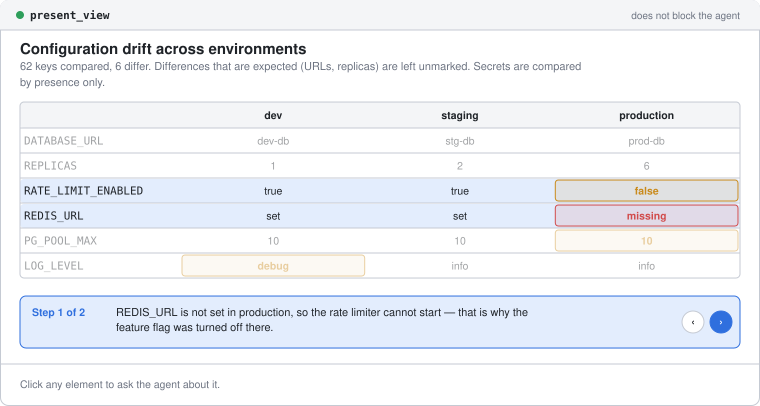

<details>
<summary>Chamada à ferramenta</summary>

```json
{
  "tool": "present_view",
  "arguments": {
    "title": "Configuration drift across environments",
    "context": "62 keys compared, 6 differ. Differences that are expected (URLs, replicas) are left unmarked. Secrets are compared by presence only.",
    "blocks": [
      {
        "type": "matrix",
        "columns": [{"id":"dev","label":"dev"},{"id":"staging","label":"staging"},{"id":"prod","label":"production"}],
        "rows": [
          {"id":"k1","label":"DATABASE_URL","cells":["dev-db","stg-db","prod-db"]},
          {"id":"k2","label":"REPLICAS","cells":["1","2","6"]},
          {"id":"k3","label":"RATE_LIMIT_ENABLED","cells":["true","true",{"v":"false","change":"changed"}]},
          {"id":"k4","label":"REDIS_URL","cells":["set","set",{"v":"missing","status":"failed"}]},
          {"id":"k5","label":"PG_POOL_MAX","cells":["10","10",{"v":"10","status":"warn"}]},
          {"id":"k6","label":"LOG_LEVEL","cells":[{"v":"debug","change":"changed"},"info","info"]}
        ],
        "mono": true
      }
    ],
    "walkthrough": [
      {
        "text": "REDIS_URL is not set in production, so the rate limiter cannot start — that is why the feature flag was turned off there.",
        "focus": ["k3","k4"]
      },
      {
        "text": "PG_POOL_MAX is 10 everywhere, but production runs 6 replicas: 60 connections against a database limit of 50.",
        "focus": ["k2","k5"]
      }
    ]
  }
}
```

</details>

<a id="36-query-plan"></a>

### 36. Plano de query e perfil de performance

**Situação.** Uma query ficou lenta. O agente roda `EXPLAIN ANALYZE` e precisa mostrar onde o tempo vai.

**Por que visual.** O plano de execução é uma árvore com custo por nó. A saída textual do Postgres é correta e ilegível; uma árvore com barras de tempo mostra o gargalo.

**O que o agente mostra.** A árvore do plano com o tempo de cada nó em barras e o nó problemático marcado.

**Interação.** Clicar num nó pergunta sobre ele (por exemplo, que índice resolveria).

| | |
|---|---|
| Ferramenta | `present_view` |
| Componentes | `tree` |
| Mecanismos | marcadores `status`, passo a passo, perguntar sobre isto |
| Resposta | nenhuma |
| Fontes | `EXPLAIN (ANALYZE, BUFFERS)`, schema e índices existentes |
| Ainda não implementado | nada |

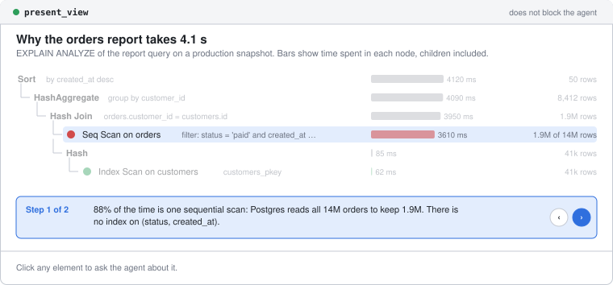

<details>
<summary>Chamada à ferramenta</summary>

```json
{
  "tool": "present_view",
  "arguments": {
    "title": "Why the orders report takes 4.1 s",
    "context": "EXPLAIN ANALYZE of the report query on a production snapshot. Bars show time spent in each node, children included.",
    "blocks": [
      {
        "type": "tree",
        "nodes": [
          {"id":"n1","label":"Sort","note":"by created_at desc","value":4120,"valueLabel":"4120 ms","meta":"50 rows"},
          {
            "id": "n2",
            "label": "HashAggregate",
            "note": "group by customer_id",
            "value": 4090,
            "valueLabel": "4090 ms",
            "meta": "8,412 rows",
            "parent": "n1"
          },
          {
            "id": "n3",
            "label": "Hash Join",
            "note": "orders.customer_id = customers.id",
            "value": 3950,
            "valueLabel": "3950 ms",
            "meta": "1.9M rows",
            "parent": "n2"
          },
          {
            "id": "n4",
            "label": "Seq Scan on orders",
            "note": "filter: status = 'paid' and created_at > …",
            "value": 3610,
            "valueLabel": "3610 ms",
            "meta": "1.9M of 14M rows",
            "status": "failed",
            "parent": "n3"
          },
          {"id":"n5","label":"Hash","value":85,"valueLabel":"85 ms","meta":"41k rows","parent":"n3"},
          {
            "id": "n6",
            "label": "Index Scan on customers",
            "note": "customers_pkey",
            "value": 62,
            "valueLabel": "62 ms",
            "meta": "41k rows",
            "status": "ok",
            "parent": "n5"
          }
        ]
      }
    ],
    "walkthrough": [
      {
        "text": "88% of the time is one sequential scan: Postgres reads all 14M orders to keep 1.9M. There is no index on (status, created_at).",
        "focus": ["n4"]
      },
      {
        "text": "The join and the aggregation are cheap once the rows are in memory. A partial index on created_at where status = 'paid' should bring the scan under 300 ms.",
        "focus": ["n3","n2","n5","n6"]
      }
    ]
  }
}
```

</details>

## 7. O que os cenários ensinam

- **Sete componentes atendem a maioria dos cenários.** `sequence`, `quadrant`, `board` e `chart` aparecem em poucos casos cada; existem porque nesses casos nenhum outro serve.
- **`matrix` e `steps` são os mais reutilizados.** Aparecem em quase todos os momentos, de permissões a progresso do agente.
- **As propriedades fazem o trabalho de vários componentes.** Diff, impacto, status de pipeline e cobertura de testes são um grafo, uma árvore ou uma matriz com `change` ou `status`.
- **Estado é a única relação declarada.** Uma opção que muda onde fica o gargalo, um antes e depois, três momentos de um incidente: tudo é o mesmo elemento com `when`. Ligar blocos diferentes não exige declaração: basta o mesmo id.
- **O passo a passo é o mecanismo das conclusões.** Sempre que o agente tem algo a concluir (incidente, pipeline, plano de query), a narrativa em passos carrega a conclusão e a view carrega a evidência.

## 8. Limites e pontos fracos

- **Exagero.** Para uma pergunta simples, a view atrapalha. A descrição das ferramentas precisa ensinar o modelo a não usá-las.
- **Precisão inventada.** Notas, posições em quadrante e probabilidades são estimativas do agente. Escalas grossas e motivo obrigatório reduzem o problema, não o eliminam.
- **Custo em tokens.** Uma chamada com três blocos custa mais do que um parágrafo. Tetos por componente limitam o tamanho.
- **Suporte dos clientes.** Depende de o cliente renderizar MCP Apps. Onde não renderiza, resta o resumo em texto.
- **Dados envelhecem.** Um retrato de pipeline ou de quadro está desatualizado minutos depois; a view precisa dizer quando foi gerada.
- **Não substitui as ferramentas dedicadas.** Quem quer monitorar usa o Grafana; a view é para o momento da conversa.

## 9. Próximos passos

1. Validar no cliente real (Copilot no Code): se o modelo escolhe a ferramenta e o componente certos em cada cenário.
2. Mecanismos pendentes: detalhe sob demanda, filtro, atualizar; respostas `rank` e `comment`.
3. Evoluir este catálogo para um cookbook em inglês: um prompt de exemplo por cenário e a chamada esperada.
